# Annotations for lines: contributors, chains and targets

Status: design (phase 1), revised for owner decision 23 (14 November: no discrete steps; a line's bits are the rarity of
being at least as good as its actual (main, tie-breaker) utilities, so annotations show quantities, not thresholds). The storyboards in §9 are running pages (`artifacts/player-web/annotations-lines.html`,
`pnpm --filter @workspace/player-web e2e:annotations-lines` captures them); the implementation plan is §11.

The owner (14 November 2026): "I want serious thought and UX work going into the annotations system for the new Lines
object type. We already established a paradigm centred on utility contributors for the grid object type, but there's
substantial extra complexity for the Line type and the multiple representations paradigm to think through and do UX
design for."

Who it is for: a 12-year-old learning linear equations, dealt one secret rule. The annotation succeeds when that child
can say, for their own rule and the line in front of them, **what number the rule reads, where it is on the line, what
what would make it rarer and what that would cost, and why another player might want the same line**. Those four sentences
are the test of every design choice below and of the persona walk in §11.4. They are also what the child needs to
negotiate with other players and to instruct an AI assistant (owner decision 9).

---

## 1. The grid paradigm, stated precisely, and what carries over

On grids (`archive/engine-v1`, `docs/annotations-design.md` §3–§6, `lib/object-views/src/explain/`) an annotation was
built on **scoring units** ("utility contributors"):

1. **A rule is decomposed into units.** A unit is one piece the rule loops over (a 2×2 block, a pair, a row, a patch),
   with its cells, the facts the rule checks on it ("✓ top row: red, green") and its **points tuple** ("(+1, 0)": one
   entry per score component, primary then secondary).
2. **The units add up to the score.** Σ unit points = the card's score, checked against the rule's own program in
   tests and at run time (`verified`): an annotation that could disagree with the score is not drawn.
3. **Two-way linking.** A list of unit boxes beside the board; pointing at a box lights its cells and draws an arrow;
   pointing at the board picks the nearest unit and scrolls its box into view. Tap selects on touch; the board is one
   keyboard stop and the boxes are tabbable.
4. **Tone from points, never stated separately** (gain, loss, zero), and never colour alone (✓/✗, "+"/"−", solid/dashed).
5. **"How this scores"** builds the chain under the units: raw score by kind of unit → how rare that is ("0.31% of random
   boards") → bits ("−log₂ P = 8.31 bits, 1 in 318").

What carries over unchanged: units cite the object's own parts; numbers come only from the rule's evaluation; every
link is two-way; tone is redundant with shape and words; the chain ends at rarity.

What does not carry over, and why lines are harder:

| Grid | Line |
|---|---|
| Many units, each a few cells; the score is their **sum**. | One line; each layer reads **one quantity** and the score is a **distance or size**, compared lexicographically. Nothing adds up. |
| The unit is drawn where it lives: one board. | The quantity lives in **several representations at once** (c is a number in the equation, a point on the y-axis, the y(0) cell of a table, the "+ c" stage of a machine). |
| The board is always legible at one zoom. | A line far from the origin or very steep makes a contributor sub-pixel (y = 290x + 59). |
| A unit's verdict is a fact on its cells. | A quantity is often **derived through a lens** the line does not show: the nearest prime to c, the triangle's area, the nearest square and its root, the crossing −c/m. The lens's output (the prime 23, two away) is not on the line at all. |
| Improving means changing cells you can see. | Improving means a **priced move** (add 2 to c) whose effect is seen through the lens ("now exactly a prime"). |

## 2. What a contributor is for a line

**A contributor is one layer of the dealt rule, shown as the chain of quantities it was computed from.** A dealt rule
has exactly two (owner decision 14): the **main part** and the **tie-breaker**. Each is a chain of *links*, every link a
quantity read off a representation through the single element API:

| Link kind | What it is | Examples |
|---|---|---|
| **element** | a coordinate or derived element of a representation | c (`si.c`), the area (`tri.area`), the crossing (`cart.xInt`), y(2) (`table.y(x=2)`), the unchanged number (`mach.fixed`) |
| **lens value** | a number-fact of an element (layered-line-rules §1.5's `num` lens) | the nearest prime to c and its distance; the nearest square to the area, its root and that root's smallest prime factor |
| **relation** | a measure between two quantities | the gap from y(2) to 37; the run of n dividing y(n) |
| **reference** | what a distance is measured to (the target is to be on it), or for a size the natural values around it | the prime 23; the square 25; the primes 29, 31 above 23 |

The **measure** is the last relation (a distance for a `min` layer, a size or count for a `max` layer); it is the
layer's score component, exactly the term v2-core records. A contributor therefore always reads, left to right:

> **● c = 25** → nearest prime **23** → **2 away** · the closer, the better

> **◆ that prime 23** · the bigger, the better

and the two together give the line its rarity: **2.13 bits (1 in 4.4 by chance)**.

**The gauge is the quantity on a ruler** (decision 23: no thresholds, notches or part steps). Each contributor has a
**lens ruler**: a magnified number line of the quantity it reads. For a distance it shows the value, the reference it is
measured to (the prime 23, the square 25, the whole number −2) and its neighbours, so "2 below" is a visible gap that
shrinks to zero; for a size it shows the value among its natural values (the primes 17, 19, **23**, 29, 31 …), bigger to
the right. A quantity that is discrete by nature (a smallest prime factor, a run) shows its natural values, never imposed
buckets. Under the ruler, what the rule wants in words: "the closer, the better", "the bigger, the better".

The two parts on one screen: the main part's ruler on top, the tie-breaker's beneath, and one sentence on how they
combine: "The main part counts first; the tie-breaker decides between lines that are equally good on the main part."

## 3. The derivation chain, and where each link is visible

For every rule the chain from the screen to the points is the same five links. The table says what shows each link at
rest (no pointer), on hover or tap, and on demand (an explicit "How this scores" fold).

| # | Link | At rest | Hover / tap a contributor | On demand ("How this scores") |
|---|---|---|---|---|
| 1 | **See**: the element in a representation | its badge (● c) on the element in the primary view; the value in the reading strip | the element lit in **every** shown view (projection, §4.2) | the elements read, with the representation each came from |
| 2 | **Read**: the quantity the rule reads (element or lens value) | "c = 25 → nearest prime 23" in the strip | the lens value drawn in the view (the prime 23 as a tick on the y-axis; the nearest square as an outline) | the lens worked: "primes near 25: 23 (2 below), 29 (4 above)" |
| 3 | **Reference and distance** | the ruler: value, reference, gap | the reference drawn in the view (a tick on the axis, a target point) | the lens worked out |
| 4 | **Bits and chance** | "2.13 bits (1 in 4.4 by chance)" | "each bit = twice as rare" | "only 1 in 4.4 random lines are at least this good on both parts" |
| 5 | **Points** | "your 2.13 × others' 3.10 = 6.60 points" | the points rectangle | how others' bits are made (§7) |

Rule: **no link is only on hover.** Everything a phone user needs is at rest or one tap away (§8).

## 4. Many representations

### 4.1 The primary alone (compact contexts)

Each rule declares one primary representation (the main layer's `rep`) and the representations it depends on
(`family.depends`). Compact contexts show the primary only:

| Context | What it shows |
|---|---|
| **Lines row** (desktop 160 × 100; phone full width × 88) | the primary drawing with the main contributor's badge and target, the reading strip in one line ("● c 25 → prime 23 · 2 away"), the step, bits, points |
| **Act log** | text only, the contributor that moved: "● c 25 → 24: now within 1. Step 11 → 15 of 27. 2.13 → 3.31 bits (1 in 10 by chance)." |
| **Chat mention** ("line 7") | a chip: the equation, with the main contributor's badge on its element: "y = 6x + **●23**" |
| **Phone One line** | the primary view full width, the two contributor cards under it, then the moves |

The badge in a chip is the same glyph as in the drawing, so a child who has learnt "● is the number my rule reads"
finds it in every context.

### 4.2 Identity across representations

A contributor has an **identity**: a colour and a shape (main ● teal, tie-breaker ◆ violet), and a short name ("c",
"area", "x₀", "y(2)", "unchanged"). Identity is drawn, not hovered: every view that contains the contributor's element
draws the same badge on it. This needs **projection by meaning**: a mark the rule placed on `si.c` is drawn on every
element with the same meaning (`cart.yInt`, `table.y(x=0)`, `mach.plus`, `seq.zeroth`). Meanings exist today
(`meaning: "yIntercept"`, `"valueAt(q)"`); two additions make projection complete:

- **meaning aliases** (an element may declare several: `table.y(x=0)` is `valueAt(0)` and `yIntercept`);
- **lens values project with their source**: the target tick for "nearest prime 23" is drawn wherever c is drawn (on
  the y-axis at 23; as "→ 23" beside c in the equation; as the y(0) column's target in a table).

The colours are reserved: no other ink on an annotated view uses teal or violet. Good/bad is never colour: progress is
a ruler's gap, a line that does not score is a grey hatch with ⊘ and a sentence. (Today a finished
bar is green in one face and red in another: W2.)

### 4.3 Views the rule does not read

A view outside `depends` is still useful (a child learning that c is also where the line meets the y-axis). It shows
the **projected badges only** (identity, no gauge), and its title says "your rule does not read this view; ● is
where your number shows here". If nothing projects onto it, it says so in one line instead of showing an unannotated
picture: "Your rule's numbers do not show in a growth pattern."

### 4.4 Switching and compare

- The switcher lists **your rule's views first** (primary ★, then the other `depends`), then "More views ▾" with the
  rest. On a phone that is one row of at most three chips and a menu, not nine tabs in four rows.
- **Compare keeps the primary.** Compare adds a second view; it never replaces the primary. Wide: side by side. Narrow
  (the game's One line pane is narrow even on desktop, and a phone): **stacked**, primary on top, compared beneath,
  both annotated. A selection lights both, so a lit twin is always visible.
- The choice persists per family in the human's view state (as `view.pinRepresentation` does today), so an assistant can
  set it.

### 4.5 Dynamic elements

Lens values and candidates are dynamic elements; each has one drawing per scene kind:

| Dynamic element | Plane | Equation | Table / sequence | Machine |
|---|---|---|---|---|
| nearest primes to c (with distances) | ticks on the y-axis, the nearest solid, others faint, each "23 · 2 below" | "c = 25 → 23 (2 below), 29 (4 above)" under the equation | the y(0) cell with the same note | beside the "+ c" stage |
| nearest square to the area | the square of that area drawn on the same scale beside the triangle, side labelled with the root | — | — | — |
| nearest whole number to the crossing | a tick on the x-axis at k | — | — | — |
| a better value one move away | a ghost of that move's line, dashed | a ghost equation under the real one | the new value in the cell | the new output |

## 5. What would raise it

The annotation's job is not finished when the child knows the score; it is finished when they know **what to change and
what it costs**. Each contributor that is below its top shows:

1. **The reference in the drawing**: the tick, point or shape the quantity is measured to (§4.5), in its colour.
2. **Moves that make the line rarer, priced**: up to three moves on the price/rarity frontier (the cheapest move that
   raises the bits, then the cheapest that raises them further), each with its new values and new bits: "Move the line
   down 1 · 5.94 ⚡ · ● c 25 → 24 · → 3.31 bits (1 in 10)". The first is drawn as a dashed ghost; pointing at another
   moves the ghost. A move that helps one part and hurts the other says so ("◆ the prime 23 → 7").
3. **When no single move is in budget**, the closest improvement, honestly labelled.

Moves are generated from the same mutators the agent pays for (spec §5), so a child can paste the sentence to their
assistant ("move line 7 down 2") and get exactly that.

## 6. Scale: the window is chosen from what the rule reads

The owner (14 November): "Choosing chart viewport params and which points to label proactively (without hover) is really
important for UX for the Line object type … Find an appropriate charting library that helps with choosing the most
interesting viewport params … and integrate with that library via including interesting points for the current
player's scoring rule for the charting library to choose display params around."

### 6.1 What the libraries actually automate

No library picks "the most interesting viewport" by itself: every one fits a window to the data it is given, so the
interesting points must come from the rule. What differs is what they do with them.

| Library (licence) | Fit a window to given points | Nice ticks | Independent x/y scales, equal-aspect option | Labels placed without collisions | React / Node tests | Size (min+gz) |
|---|---|---|---|---|---|---|
| **d3-scale + d3-array** (ISC) | extent → domain, `nice()` | yes (`ticks`, `nice`) | yes; aspect is the caller's | no | pure functions; any renderer; runs in Node | ≈ 12 KB |
| Observable Plot (ISC) | domain from every mark's data, `inset`, `nice` | yes (d3) | yes; `aspectRatio` | no (text marks are not de-overlapped; `tip` only keeps one tooltip in frame) | returns a DOM node: React needs a ref; Node needs jsdom; per-element interaction is post-processing | ≈ 70 KB + d3 |
| Vega-Lite (BSD-3) | `zero: false`, `nice`, padding | yes | yes | axis-label overlap only; Vega's `label` transform de-overlaps text against marks (bitmap occupancy) | async view runtime, not React-native | ≈ 300 KB+ |
| JSXGraph (MIT/LGPL) | `zoomElements([...])` fits the board to elements | yes | yes; `keepaspectratio` | `label.autoPosition` | imperative board, needs a DOM | ≈ 200 KB |
| Mafs (MIT) | no (you set the `viewBox`) | yes | `preserveAspectRatio` | no | React-native | ≈ 40 KB |
| function-plot (MIT) | no (domains given) | yes (d3) | yes | no | d3 DOM | ≈ 40 KB + d3 |
| uPlot (MIT) | y auto-range for series | yes | yes | no | canvas | ≈ 20 KB |
| Plotly (MIT) | `autorange` with padding | yes | yes; `scaleanchor` | annotations are not de-overlapped | heavy DOM | ≈ 1 MB |
| d3fc-label-layout (MIT) | — | — | — | greedy, annealing and remove-overlaps strategies over label rectangles; no obstacles (the line), annealing is random | pure strategies but d3 v1 dependencies | ≈ 6 KB |

**Choice: d3-scale (with d3-array) for the window and ticks; our own small placer for labels.** d3-scale is the
fitting and tick engine that Observable Plot, Vega and Recharts themselves use, as pure functions: the window is
computed in Node tests exactly as in the browser, and the drawing stays our React SVG, which every element's identity,
pointer and keyboard behaviour needs (design §4, §8). Plot or Vega would add a second rendering model for the same
fit. For labels, the only library that avoids the line itself is Vega's `label` transform, which cannot be used
outside Vega's scene graph; d3fc-label-layout's greedy strategy is the right algorithm but knows no obstacles and pulls
in d3 v1, so `lib/v2-views/src/plot/labels.ts` is that greedy candidate-position algorithm (eight positions per point,
in growing rings, a leader when far) with the line, the axes and every point's mark as obstacles, deterministic.

### 6.2 The contract: interesting points come from the rule

No second source: the plane gathers its interesting points from the rule's own marks, **projected by meaning** onto the
plane (`crossing.x0` → the x-intercept, `si.c` → the y-intercept, `table.y(x=2)` → the point at x = 2), with a
priority each:

| Priority | What | In the window | Label at rest |
|---|---|---|---|
| 1 | a focus or measure mark's element; the nearest candidate (the target); the triangle the rule reads | always | always, clear of each other, the line and the axes |
| 2 | other candidates; the rule's short notes; the intercepts when the rule cites nothing on this plane | always | where there is room |
| 3 | the representation's own landmarks: the origin, the intercepts | unless one would shrink what matters more than 8-fold on an axis and lie more than 30 units away | on hover/tap (titles) |

Then (`plot/viewport.ts`): the extent of the points, padded; **one scale** for both axes while the narrower content
still fills an eighth of its axis (a gradient then looks like itself); else **each axis its own scale**, niced to round numbers, and the
picture says "Scales differ: across, one square is 0.05; up, one square is 20". An axis left outside the window is named
at the edge ("x-axis ↓ (y = 0)"). A region thinner than 10 px is drawn as a schematic in a corner, "not to scale". A
fraction with a bottom number above 16 is written "≈ 6.00", whole numbers from 10,000 are grouped, and a tick number
under a label is left out. Tests: `lib/v2-views/test/plot.test.ts` checks every priority-1 point inside the window and
every priority-1 label on screen and clear of the others in the compact and expanded boxes (the expanded SVG then scales
to the card), on
y = 290x + 59, a near-horizontal line, c = 27,720, lines through the origin, a near-vertical line, and each pool rule's
top state; `e2e/annotations-lines.ts` measures the same in the browser at 390 and 1440 px on the gallery's hard cases (`v2-views.html?section=plot`).

Before and after, y = 290x + 59 under Square Area (the fixed ±12 window made the triangle a sliver):

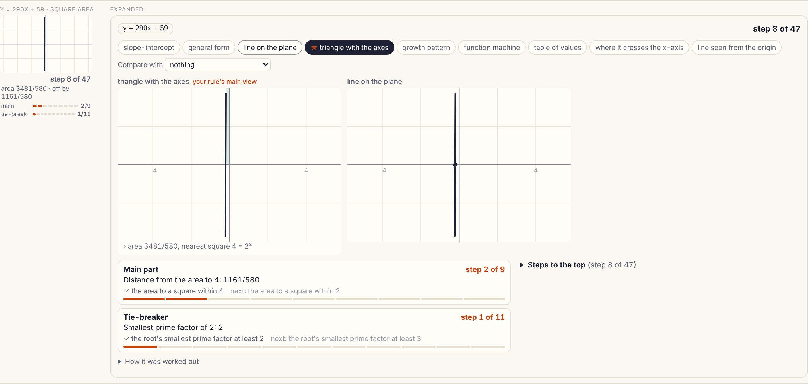
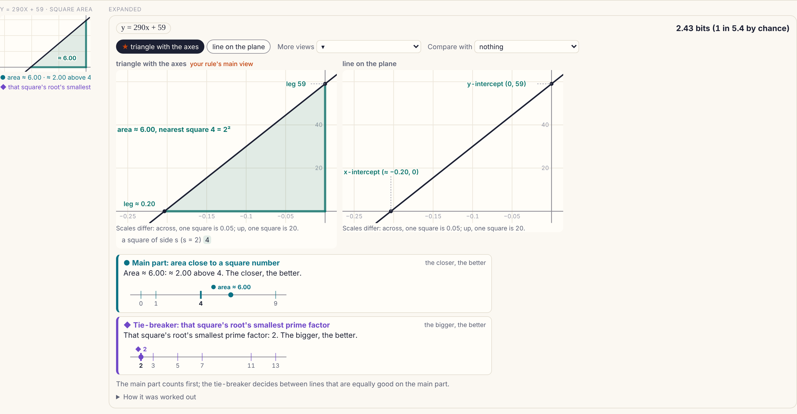
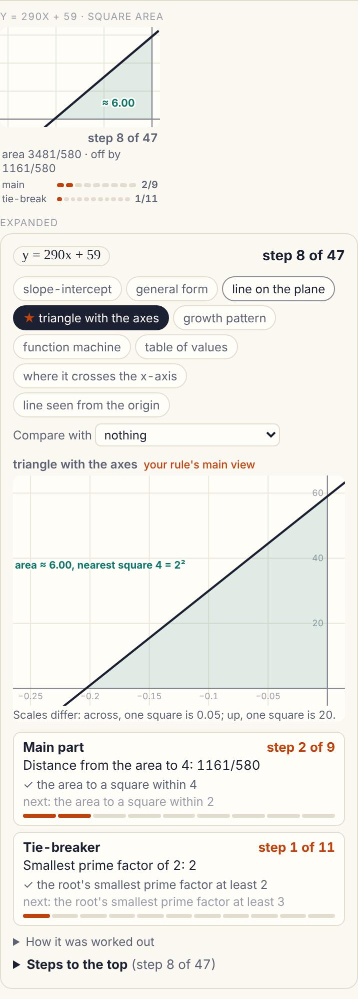
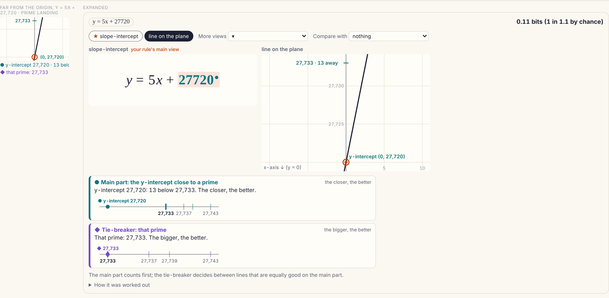

### 6.3 Still to come

The lens ruler (§2) in the faces themselves, for references a window cannot separate (27,720 against
the prime 27,733 is legible; 10⁶ against 10⁶ + 1 is not); the same fitting for tables (the columns the rule reads).

## 7. Other players

Points = your bits × the others' bits (summed). Negotiation needs a reason another player might want a line. What a
player may see (spec §9 disclosure, unchanged): the **others' bits on each line, summed**, never their rules. So:

1. **At rest**: the others' bits are the height of the points rectangle and a number ("others: 3.10 bits"); Lines can
   be sorted by it; a line that others want and you do not is marked "others want this" (a chance to trade).
2. **On a line**: "Others want this line 3.10 bits: somebody's rule finds it 1 in 8 rare. You cannot see their rules;
   ask them." That sentence is the prompt to talk.
3. **Told rules** (proposed, the owner's to decide, §12 Q1): a player may **show their card to someone** (an affordance,
   so their assistant can too). The receiver's views then draw the shower's contributors in a third identity (◇ grey
   outline, with the shower's name), on the same line, with their targets. Two told rules on one line show where they
   pull together and where they collide ("Ada's ◇ y(2) wants 37; your ● c wants a prime: c = 7 would give both").

## 8. Phone, touch, keyboard, screen reader

- **Tap selects; nothing depends on hover.** A tap on a contributor card, a badge or an element selects that
  contributor: its links light in every view, its chain opens, and a "● c selected ✕" chip at the top of the pane
  clears it. A second tap or ✕ clears. A tapped number never stays lit without that chip.
- Contributor cards are buttons; arrow keys step between contributors and links; Escape clears.
- Each view has an accessible name and a text form; each contributor has a sentence (§10) that a screen reader reads as
  the card's name; the chain is a list.
- One line on a phone: primary view, the two contributor cards, the moves, then the switcher ("Your rule's views: ★
  equation · triangle · More ▾"), then "How this scores" folded.

## 9. Storyboards

Every frame below is a running page: `annotations-lines.html?rule=<id>&frame=<f>` on the player-web dev server, drawn
by the real lib/v2-views faces (since the contributors PR; the first storyboards were a hand-written prototype). The numbers are
real: the rules, element values, moves and prices come from v2-core and v2-linear, and the bits from each rule's value
function (`valueLookup` on the records in `lib/v2-valuation/values`, owner decision 23). Some sentences below were
written for the prototype; the screenshots are the faces as built.

### 9.1 Prime Landing: y = 6x + 25, tie-breaker "that prime as big as possible"

Primary: the equation; the rule also reads the graph. The child sees **● c = 25** with its badge in the equation and on
the y-axis; the rule reads the nearest prime, **23, 2 below** (29 is 4 above): a ruler under the card magnifies that
stretch of numbers with the primes as ticks. The tie-breaker ◆ is that prime, 23, on a ruler of primes. The line is
**2.13 bits (1 in 4.4)**. The moves are honest about the trade: "Move the line down 1 · 5.94 ⚡ → 3.31 bits";
"Slide the line to y = 6x + 7 · 8.94 ⚡ → 7.09 bits" (on a prime, but the tie-breaker falls from 23 to 7); "… y = 6x +
13 · 9.94 ⚡ → 10.10 bits".

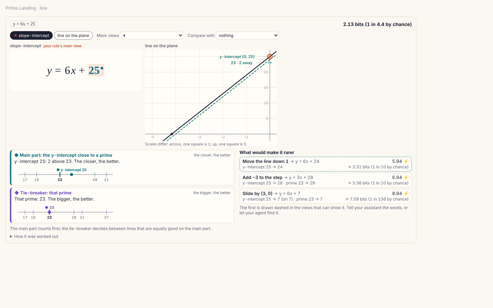

Selected ● c on a phone: the chip "● c selected ✕" says what is lit; the graph is stacked under the equation so the lit
twin is visible; "How this scores" is open with the six links.

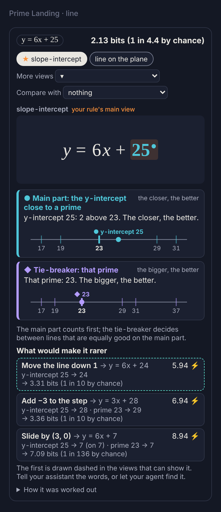

### 9.2 Square Area: y = −x + 7, tie-breaker "the root's smallest prime factor"

Primary: the triangle. The legs 7 and 7 are drawn thick and labelled; **area 24½** is written in the triangle, not under
it; the nearest square **25 = 5 × 5** is drawn as a 5 × 5 square on the same grid, so "close to a square number" is two
shapes of nearly the same size; the ruler shows 16, 25 and 36 with the area ½ from 25. The legs project onto the graph as the two
intercepts. Tie-breaker ◆: the square's side 5 (a prime), on a ruler of primes. Moves: "Change the gradient to −2 ·
6.44 ⚡" (area 16, exactly, but the root falls to 4) and "Multiply every output by 2 · 10.17 ⚡" (area 49 = 7², and the
root rises to 7), each with its new bits: the moves teach that the two parts can pull apart or
together.

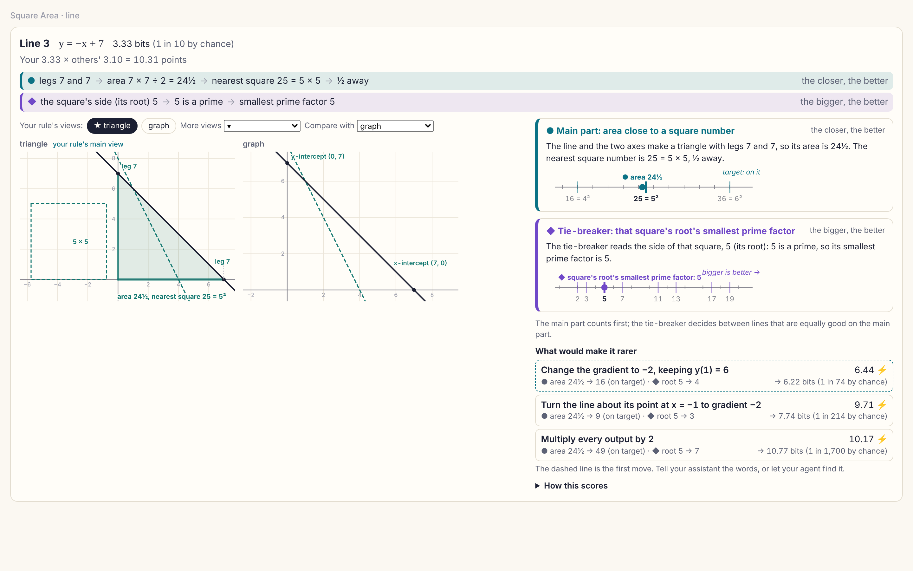
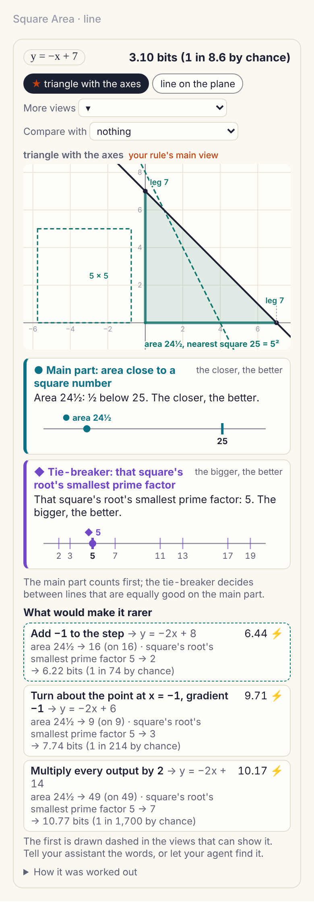

### 9.3 Whole Crossing: y = 3x + 7, tie-breaker "that whole number's largest prime factor"

Primary: the graph. The crossing **x₀ = −2⅓** is ringed on the x-axis, the nearest whole number **−2** is ⅓ to its
right; the strip shows the solving ("0 = 3x + 7 → x₀ = −2⅓"); 1.12 bits. "Move the line down 1 · 5.94 ⚡" puts the
crossing exactly on −2, and the move shows the bits it would bring. Compared
with the table of values (the main view kept), the crossing projects as "y < 0 at x = −3, y > 0 at x = −2".

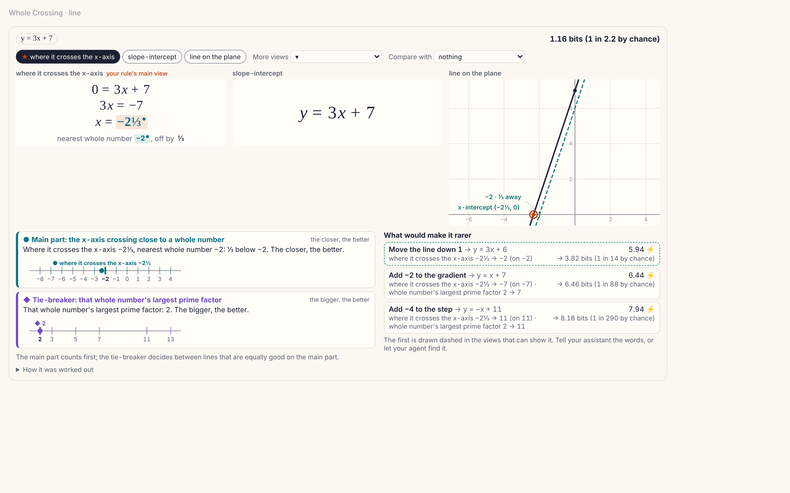
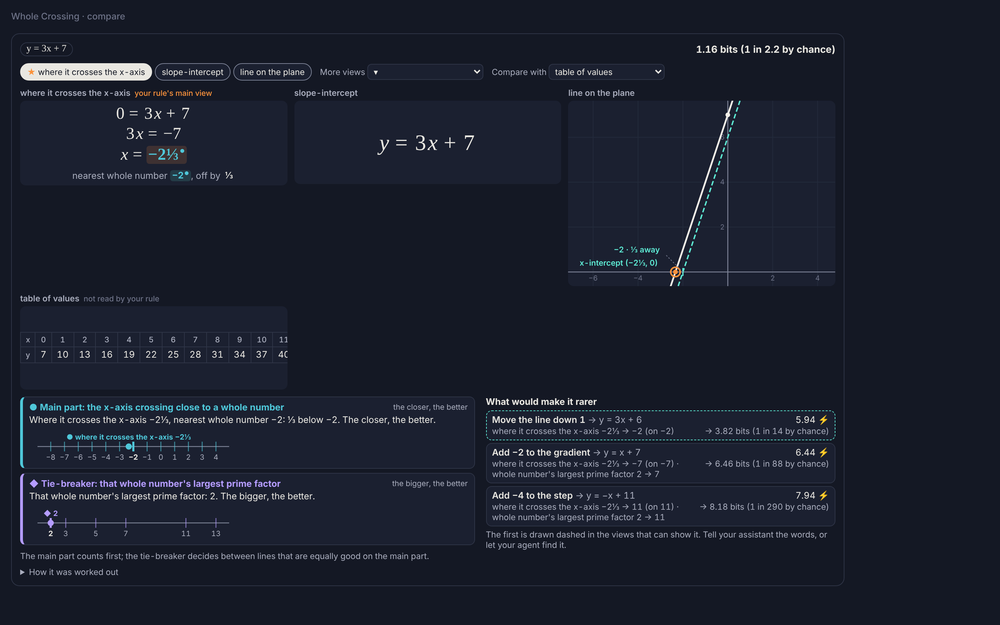

### 9.4 Treasure (x = 2, treasure 37): y = 15x + 6, tie-breaker "the gradient's smallest prime factor"

Primary: the table at x = 2 (substitution). **● y(2) = 15 × 2 + 6 = 36**, the treasure 37, **1 short**; the graph draws
the treasure (2, 37) as a hollow target; the tie-breaker ◆ reads m = 15 = 3 × 5, smallest prime factor 3 (bigger is better).
7.73 bits (1 in 212). Others want this line 3.10 bits, and Ada has shown her card (Prime Landing): ◇ her
rule reads c = 6, 1 from the primes 5 and 7, drawn on the same views in grey with her name. The frame finds the move
that lifts both: "change the gradient to 16, keeping y(1) = 21" (5.94 ⚡) gives y = 16x + 5: y(2) = 37 exactly for you
and c = 5, a prime, for her: rarer for both. That is the sentence a child takes into a negotiation.

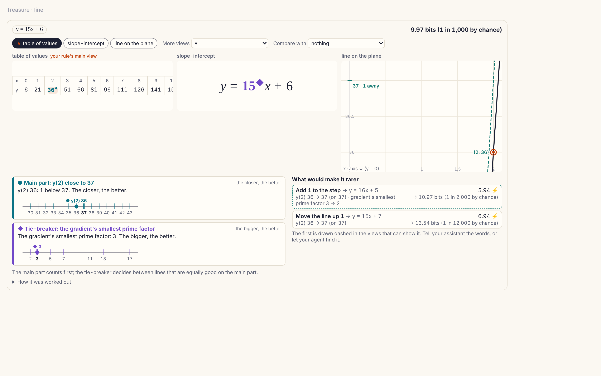
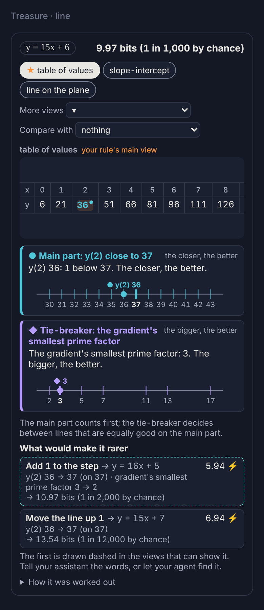

### 9.5 Divisibility Ladder: y = 12x + 12

The table shows the columns the rule reads, y(1) … y(5), each "÷ n = whole" until the first that is not: y(5) = 72 is
not a multiple of 5, so the run is 4. The run is the contributor; its ruler counts whole numbers.

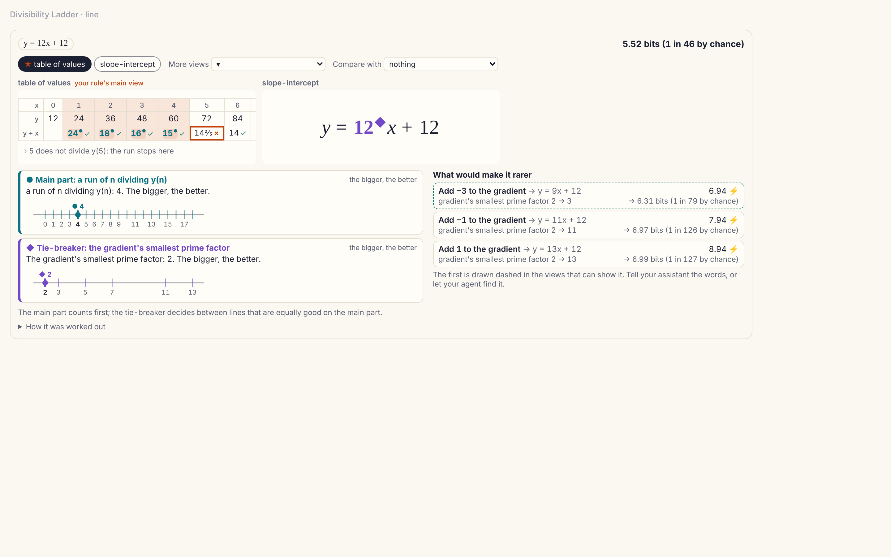

### 9.6 Scale: y = 290x + 59 (a line a real game produced)

The window fits the contributors with unequal scales and says so ("across, one square is 1; up, one square is 20. The
line really is 290 times steeper than a 45° line"). Under Prime Landing (tie-breaker: the gradient's largest prime
factor) c = 59 is a prime and m = 290 = 2 × 5 × 29; "change the gradient to 296, keeping y(1) = 349" reaches the top
(c = 53, 296 = 2 × 2 × 2 × 37). Under Square Area on the same line the triangle is a sliver: it gets a zoom inset, the
area is written "≈ 6.00" instead of 3481/580, and since unequal scales cannot draw a square as a square, the nearest
square is shown on the ruler only.

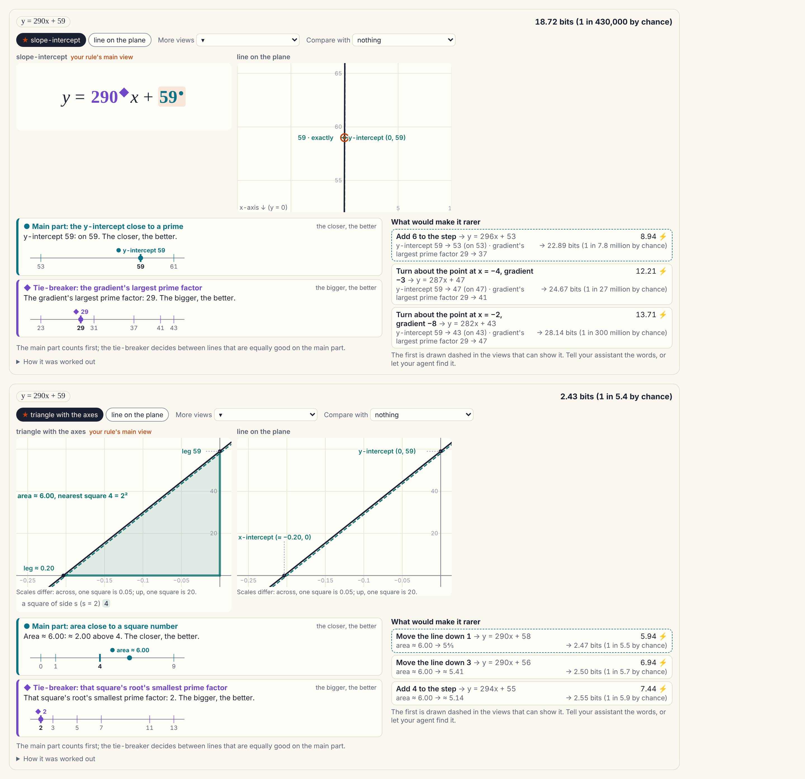

### 9.7 Compact contexts and the goal card

Lines rows, a chip, the act log and a chat mention, all with the same badges. The goal card shows **your line on the
rarity** (the line in focus, or your best line): its rulers, its bits, the moves that would make it rarer and the bits
of the rarest lines for the rule; the worked example is below it, not instead of it.

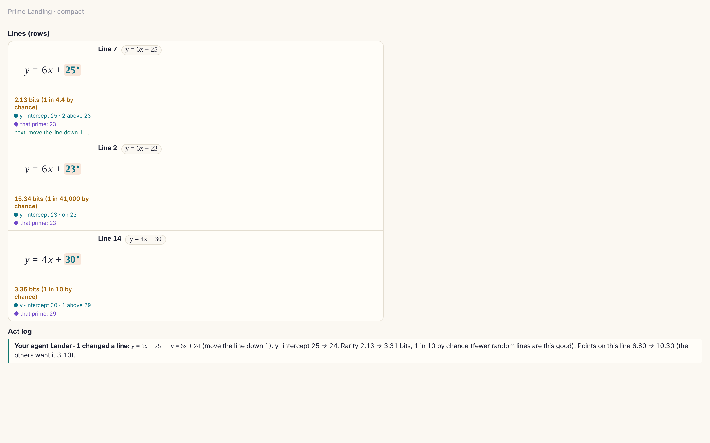
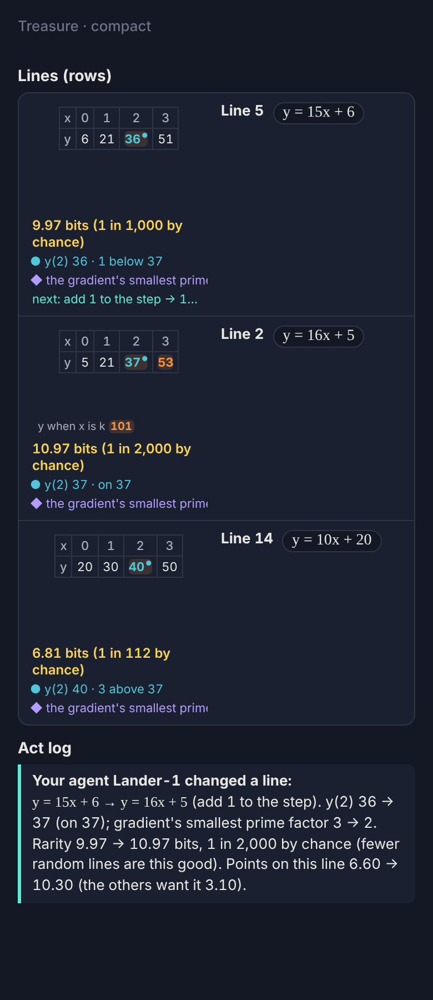
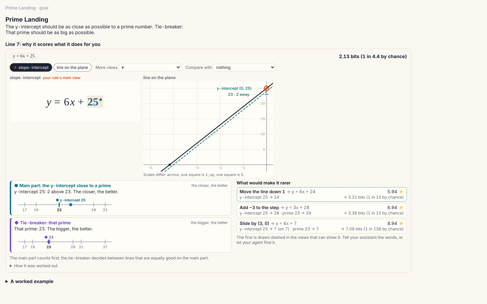

## 10. Wording rules for generated sentences

1. **No parameter letters.** Never "A", "k", "T", "q" or "b" in player text: substitute the dealt values ("the area to
   a square", "y(2) to 37"). Moves name the thing moved ("move the line down 2", "make the gradient 5"), never "add −1 to
   b".
2. **No "distance … : 0".** A zero distance is "exactly": "c = 23 is a prime". A size is "at least …".
3. **No steps or thresholds** (decision 23): no "step n of N", no "within ¼" buckets, no "≥ 5" pills. State the
   quantity ("c is 1/12 from a whole number"), its bits to 2 decimals with "1 in N by chance", and what a reachable better
   value would be worth.
4. **Name every lens value the first time.** "Smallest prime factor of 2: 2" becomes "the area is close to 4 = 2 × 2;
   its root is 2, whose smallest prime factor is 2". "Root" is always "the square's root (the side of the square)" on
   first use.
5. **"Away" carries a direction and a unit**: "2 below", "¼ to the right", never "5 · 0 away".
6. **Quote the value with its name**: "● c = 25", "◆ the prime 23", "area 24½".
7. **Bits always pair with a chance once per view**: "4.72 bits (1 in 26 by chance)".
8. **Unreadable fractions become decimals**: a bottom number above 16 is written "≈ 6.00" (the exact value on demand).
9. **The four persona sentences are generated**, in the reading strip and in "How this scores": what the rule reads,
   where it is, what would make it rarer and its price, and what others' bits say.

## 11. Implementation plan

### 11.1 Contracts (one element API for utilities and annotations)

The rule's evaluation stays the only source: annotations never recompute a score.

1. **`num` representation** in v2-linear (layered-line-rules §5 item 2): dynamic elements `nearestPrime(x)`,
   `nearestSquare(x)`, `nearestWhole(x)`, `spf(n)`, `gpf(n)`, each a function of one value. Rules read lens values
   through `ctx.read` (they compute them today with numbers.ts and record them only in labels), so the chain's links are
   reads, in order, with their values.
2. **Term chain**: a term's `from` lists its links in chain order (source element first, lens values next).
3. **The reference as a mark**: the candidate mark the rule already places (the prime 23 on the y-axis), for every rule
   that measures a distance (Treasure and Whole Crossing still lack theirs; asked of the spec lead).
4. **Meaning aliases** on element declarations, for projection (§4.2).
5. v2-views: `contributors(annotation)` (pure: chain, ruler, identity, references, sentences), `moves(rule, state, k)` (the
   price/rarity frontier, on the continuous valuation), a scale-aware plane window, projected marks, and the faces rebuilt on them.

Items 1–4 are lib/v2-linear and lib/v2-core changes: proposed to the app session as exact diffs, merged by whichever
session holds those files.

### 11.2 Order of pull requests

Done: the design (#458, #468); the fitted plane and labels (#462, #471); the line element without a window (#465); the
nearest square (#483); contributors, rulers, moves on the value function and the faces without steps (#489, this list's
items 2 and part of 3 and 5); identity badges (● main part, ◆ tie-breaker) on the elements each part reads, projected by
meaning into every view, with the part named in the element's title. Still to do: the app's value record wired into One
line, Lines and the goal card (W5, from myRule `value`); the persona walk.

1. This document and the storyboard gallery.
2. v2-views: contributors model and wording (tests first: the four storyboard lines, the wording rules as assertions),
   rulers instead of steps and thresholds (on the spec lead's continuous valuation), identity colours.
3. v2-views: projection by meaning, badges in every scene, stacked compare, switcher with "More views", tap selection.
4. v2-views: the plane fitted to the rule's points (done: #462); ghost moves; the price/rarity frontier of moves.
5. player-web: One line, Lines rows and the goal card linked to the focused line; others' bits sentence.
6. e2e for the flow; the persona walk (§11.4).

### 11.3 Tests

Unit: every family's contributors on the storyboard lines (chain, target, sentence); no parameter letter, no
"distance … : 0", no "step", "within" bucket or "≥" pill (property over every dealable rule × seeded lines); window fitting keeps every
contributor ≥ 6 px or inset. E2E (gallery, both widths): tap selects and the chip clears it; compare keeps the primary;
a selection lights a visible twin.

### 11.4 Persona walk

A non-coder persona (Jo, desktop; Sam, phone) is dealt a rule in a practice game and must say, unaided: what number
their rule reads, where it is on their line, what would make it rarer and what it would cost, and why another player
might want the same line. Pass: all four correct for two different rules.

## 12. Open questions for the owner

Interim rulings from the coordinator until the owner answers: Q1 no told rules (disclosure unchanged); Q2 unequal
axis scales allowed when stated; Q3 the cheapest move shown at rest.

1. **Told rules.** May a player show their rule card to chosen players (§7.3), so both see each other's contributors on
   shared lines? It changes disclosure (today: never another's rule) but only by the owner of the rule's choice.
2. **Unequal axis scales.** Is a plane with different scales across and up acceptable for a 12-year-old if it says so
   and keeps a slope glyph (§6.1), or should steep lines always fall back to insets and numbers?
3. **Moves shown.** Showing priced moves teaches what to tell the assistant, but it also does part of the thinking for
   the child. Show the cheapest move at rest (proposed), or only on request?
