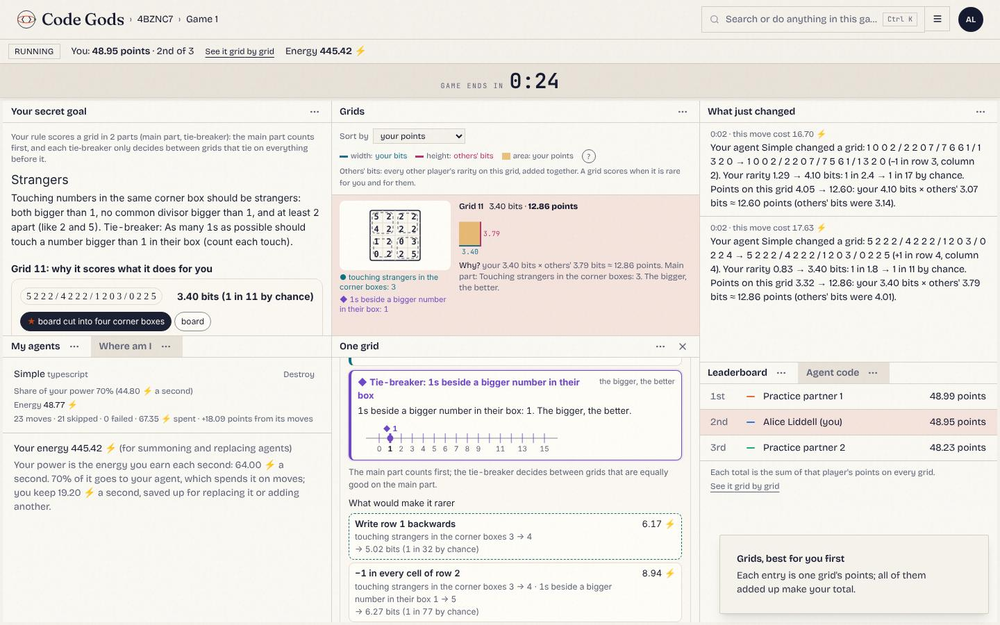
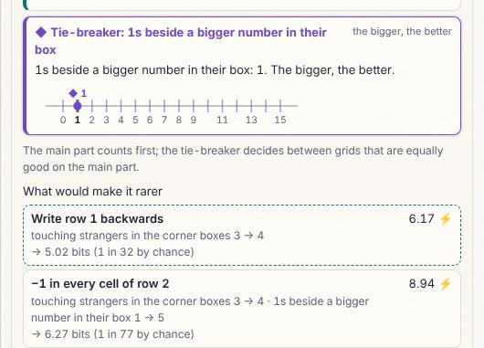
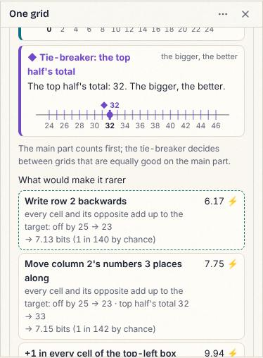

# Grids on engine v2: design note (14 November 2026)

Status: the design for milestone M4 ("grids ported", [integration-plan.md](integration-plan.md) §5.5), written before
the code. It follows the owner's decisions ([owner-decisions.md](owner-decisions.md), which override this note) and the
contracts of [spec.md](spec.md). It replaces spec §13's sketch. What it carries over from the old grid
(`archive/engine-v1`) is the board itself: the beginner's colourless 4×4 board of digits (the owner: "We eliminated
colour from the beginner grid game to increase concentration of interest within one dimension"). It does not carry the
old rules as they were: they were scored on a flat law and several were yes/no counts or read overlapping units, which
the v2 rules cannot be (§6).

## 0. In one page

- **The object** is one N×N board of whole numbers, read row by row. Beginner variant `grid-4-d10`: 4×4, every cell 0–9.
- **Energy is per cell**: φ(board) = Σ cells (v/2 + log2 Z), so a board's energy is **half its total** plus a constant.
  The gravitational centre is the empty board (all 0s). Every 1 added anywhere makes a board √2 times rarer.
- **Product-form law.** Every mutator is a potential move (a move and its inverse are proposed with equal weight), so the
  walk's stationary law is π(board) = Π cells p(v), p(v) = 2^−v/2 / Z: the cells are independent and identically
  distributed. A rule whose layers add up over disjoint units of cells (rows, boxes, opposite pairs, cells) has an
  **exact** value at every rung, by convolving the units' laws: no simulation, about a second a rule. Any other rule
  (overlapping windows, rows with columns, regions, histograms) is **sampled** directly from π, with importance
  sampling for the rare rungs (owner decision 22, §5.2); the sampler is validated against every exact rule.
- **Nine representations**, each a way a 12-year-old can read the board: the cells, the row and column totals, the
  opposite pairs, the rows read backwards, the steps along each row, the four corner boxes, the nine 2×2 squares, the
  leaps two cells along a row, the board folded on its other diagonal. Nine mutators, each tied to one of them; those
  that only rearrange numbers cost no energy.
- **The beginner pool is the old beginner grid's eight rules, regraded** (owner decision 22): each one main layer
  (school arithmetic) and three alternative tie-breakers. Seven are exact; Spread of Three is sampled. Three new
  families (Steady Steps, Box Totals, Prime Cells) form a second pool.

## 1. The object

### 1.1 State and canonical form

```ts
interface GridState { readonly cells: readonly number[] }   // N·N whole numbers, row-major: cells[r·N + c]
```

- **Canonical form**: the array itself. A board is not identified with its rotations or reflections: rules read rows,
  columns and corners, so orientation matters, and turning the board is a move (`turn.spin`).
- **Wire**: rows joined by `/`, each row its cells' digits (`0120/3001/0000/9000`). A variant whose cap is above 9
  separates cells with `,` (`10,0,3,1/…`). `decode` refuses anything not canonical (wrong size, a value past the cap).
- **Sites**: 1. A grid is one site; mutators and representations address cells, lines, pairs and boxes through their
  arguments and element names, not through sites. Each object is an independent universe (spec §2.6).

### 1.2 Variants and parameters

| Param | Values | Meaning |
|---|---|---|
| `size` | 4 (later 5, 6) | N: the board is N×N |
| `cap` | 9 (later null) | the largest number a cell may hold (null: any whole number; the energy keeps such boards normalisable) |
| `step` | ½ | bits of energy per unit in a cell (§2) |

Shipped first: **`grid-4-d10`** (4×4, cap 9, step ½), the beginner board. A tiny **`grid-2-d3`** (2×2, cap 2: 81
boards) exists for tests only: every value on it is checked against brute-force enumeration of all boards. Wider boards
and unbounded cells are later variants (a pull request each, owner decision 7).

### 1.3 Read length φ

φ(board) = Σ cells w(v), w(v) = v/2 + log2 Z, Z = Σ_{v=0}^{cap} 2^−v/2 (Z = 3.31 on digits, log2 Z = 1.73). The Kraft sum
over all boards is exactly 1 (the code is complete on 0…cap per cell), so π = 2^−φ needs no normaliser. On
`grid-4-d10` the empty board reads in 27.6 bits and the board of all 9s in 99.6. A full read of a cell costs w(v): 1.7
bits for a 0, 6.2 for a 9.

## 2. Energy: why half the total

The owner's principle (decision 11): moving to larger or more complex numbers must cost more than coming back, so the
board has a gravitational centre and energy is a description length. Two codes were considered for a cell:

- **Steps** (chosen): v costs v/2 bits more than 0. Energy is half the board's total, a fact a 12-year-old can say
  ("the bigger the numbers add up to, the rarer the board"), and it is the same principle as the line's additive moves
  (decision 17: "Adding to a number should have cost proportional to the absolute value of the amount added"). The law
  of a cell is geometric: P(0) = 0.30, P(1) = 0.21, P(5) = 0.05, P(9) = 0.013.
- **Factorisation** (the line's number code): 7 would cost more than 8 or 9, and 0 would hold half the mass (P(0) = 0.6
  on digits), so a newborn board is mostly blank. It suits unbounded lines, where primes are the axis of rarity, less a
  board of digits whose rules are sums and differences.

So the grid's axis of rarity is size: a rule that wants big numbers fights gravity, and a rule that wants a fixed total
gets exactly the boards of that total, equally weighted (π depends on the board through its total alone). That second
fact is what makes tie-breakers clean: at the top of "every row adds up to 12" every board with those row totals is
equally likely, so a tie-breaker's rarity there is a plain count of arrangements.

`step` is a variant parameter. The code is listed as a decision for the owner in §8 (steps on the beginner board).

## 3. Representations and their elements

Every representation is a scene of kind `grid` (spec §11.1; the one new renderer): the board drawn as cells, with the
representation's own elements drawn on it (margins, groups, arrows). Element values are numbers. Cells are named `rRcC`
with 0-based R and C (labels say "row 1, column 1"); every derived element names the cells it is made of, so marks and
cross-highlighting work by meaning (`cellValue(r, c)`, `rowTotal(r)`).

| Id | What a 12-year-old reads | Coordinates | Derived elements |
|---|---|---|---|
| `cells` | the board | `r0c0` … `r3c3` | `total` (all cells) |
| `tally` | the board with each row's and column's total in the margin | — | `row0` … `row3`, `col0` … `col3`, `total` |
| `turn` | each cell joined to its opposite (where a half turn of the board takes it) | — | `pair0` … `pair7`: the two cells' total, pairs numbered by the top-half cell in reading order |
| `mirror` | each row beside itself read backwards | — | `gap0` … `gap3`: how far row r is from reading the same both ways, \|a − d\| + \|b − c\| |
| `steps` | the step from each number to the next along a row | — | `s(r,j)` = cell (r, j+1) − cell (r, j) as `s00` … `s32`; `bend0` … `bend3`: how far row r's steps are from equal, \|s0 − s1\| + \|s1 − s2\| |
| `boxes` | the board cut into four 2×2 corner boxes | — | `box0` … `box3` (top-left, top-right, bottom-left, bottom-right): the box's total; `pairs0` … `pairs3`: how far the box is from two different pairs; `strangers0` … `strangers3`: touching strangers in the box |
| `windows` | every 2×2 square (nine, overlapping) and its spread | — | `w0` … `w8`: biggest minus smallest in the square, by top-left cell in reading order |
| `leaps` | each number and the number two cells along its row | — | `leap0` … `leap7`: the far cell minus the near one |
| `fold` | the board folded along the diagonal from the top-right corner | — | `fold0` … `fold5`: a cell minus the cell it folds onto; `line`: the fold line's total |

The tallies are the required "row/column tallies"; the others are the representations rules anchor to. A priced query of a representation returns its static elements (spec §3.1); a
read of `tally` costs the bits of its eight totals, capped (as for lines) at the board's read length.

## 4. Mutators and their handling fees

Nine mutators, so "which" is log2 9 = 3.17 bits, as on the line. Positions are choices (their log2 is the handling fee
of the move: it is the same in both directions). Amounts are priced in proportion to their size, against the rest of
the call (far moves are dear, spec §12.4): with o the bits of which + the call's choices, k costs log2(1 + 2^(o+1))·|k| − o,
so the call's whole fee is log2(1 + 2^(o+1))·|k| and a move of k costs exactly |k| moves of 1 (cells.add: 8.18 bits a
unit; tally.add, turn.balance, steps.tilt: 7.18; boxes.add: 6.19). Every call also pays the confining surcharge max(0, φ(after) − φ(before)), which
here is half the growth of the total. A result past the cap or below 0 is refused, in both directions alike.

| Id | Rep | Arguments (bits) | Effect | Inverse | Price of the cheapest call |
|---|---|---|---|---|---|
| `cells.add` | cells | cell: choice of 16 (4); k: amount | cell += k | `cells.add(cell, −k)` | 8.18 a unit (+½ when k = 1) |
| `cells.swap` | cells | a, b: two choices of 16 (8; a = b is refused) | swap them | self | 11.17, no surcharge |
| `tally.add` | tally | line: choice of 8 rows and columns (3); k: amount | every cell of the line += k | `tally.add(line, −k)` | 7.18 a unit (+2 when k = 1) |
| `tally.rotate` | tally | line (3); j: choice of 3 (1.58) | the line's cells move j places along, the last coming round to the front | `tally.rotate(line, 4 − j)` (same price; j is a choice, not a size, so that its inverse 4 − j costs the same) | 7.75, no surcharge |
| `turn.spin` | turn | one of 7 turns and flips (2.81) | the whole board turned a quarter, half or three quarters, or flipped (two axes, two diagonals) | the opposite turn; flips are their own | 5.98, no surcharge |
| `turn.balance` | turn | pair: choice of 8 (3); k: amount | the pair's top-half cell += k, its opposite −= k (the pair's total is kept) | `turn.balance(pair, −k)` | 7.18 a unit, no surcharge |
| `mirror.reverse` | mirror | line (3) | a row or column written backwards | self | 6.17, no surcharge |
| `steps.tilt` | steps | line (3); k: amount | the line's cells += 0, k, 2k, 3k (every step along it grows by k) | `steps.tilt(line, −k)` | 7.18 a unit (+3 when k = 1) |
| `boxes.add` | boxes | box: choice of 4 (2); k: amount | every cell of the box += k | `boxes.add(box, −k)` | 6.19 a unit (+2 when k = 1) |

The cycle test is the hard gate it is on the line: lib/v2-grid's potential test proposes every call from a corpus of
boards on every variant and fails on any one-way move or any pair of opposite moves whose weights differ.

## 5. Value: an exact sum where one exists, direct sampling everywhere else

The owner (decision 22, on the first draft's "what the exact method rules out"): "I don't want to give up the affordance
for grid rules like these. If we can calculate calibration stats for such rules accurately enough using simulation,
then keep them." And decision 20: exact scoring never blocks anything. So each grid rule is valued by whichever method
reaches a principled value, chosen by what the family declares: an exact convolution when it declares units (§5.1), the
direct sampler otherwise (§5.2). A row-by-row transfer matrix (§5.3) is the exact method still to build for rules whose
dependence crosses units.

### 5.1 Exact: convolution over units

**The law.** π(board) = Π cells p(v) (§0). A rung's value is V_k = −log2 π(level ≥ k), as for lines (spec §7.1).

**The class every dealt grid rule is in ("unit-additive").** A family declares a partition of the cells into disjoint
**units** of at most four cells (rows, boxes, opposite pairs, single cells); each layer's term is a sum over the units
of a quantity that depends on that unit's cells alone. Then the pair (main term, tie-breaker term) is a sum of
independent random pairs, one per unit, and its exact law is the convolution of the units' laws. The engine never
duplicates rule logic: it reads each unit's contribution by evaluating the rule itself on boards that differ from a
reference board only in that unit, and it checks the declared additivity on 400 boards drawn from π before using it
(as `separable` is checked on lines). The interface is `gridSums` in lib/v2-grid/src/sums.ts:

```ts
interface GridSums { units(variant: Variant): readonly (readonly number[])[] }   // disjoint cell indices
```

**Recipe per family** (§6): enumerate each unit's configurations (at most 10^4 for a unit of four digits) with weight
Π p(v); record (main contribution, tie contribution); convolve the units' 2D laws (a few hundred support points);
level each support point with the rule's own ladder; sum upwards. On a bounded board the result is exact up to
floating point (no outside mass); on an unbounded variant each unit is enumerated within a bit budget and the outside
mass bounds the error, as `integersWithin` does for lines. Every rung is then `exact` in the artefact (spec §7.2), and
continuity (decision 13) is read off the law: each dealt layer must take at least six values of probability 2^−25 or more.

**What it buys.**
- Every rung of every dealt pairing is exact to the top, with no compute budget and no cap: calibrating the whole pool is
  seconds, so a family can deal many parameter values (several targets) at no cost.
- Tie-breakers have no islands: the restricted chains that failed on Prime Staircase do not exist here.
- Exact conditional sampling: a board at any rung can be drawn exactly (unit by unit), which gives the goal card's
  worked examples and the tests' corpora.
- The 2×2 test board lets every exact value be checked against brute force over all 81 boards.

**What the exact class leaves to the sampler.**
- **Overlapping units**: the nine overlapping 2×2 windows (Spread of Three), touching pairs across the whole board
  (Strangers), runs that cross rows. A transfer matrix over rows (§5.3) could sum some of them exactly.
- **Layers on different partitions**: a main layer on rows with a tie-breaker on columns, a magic square (rows and
  columns both). A tie-breaker must read the main layer's units or finer ones (single cells).
- **Whole-board shape**: regions, paths, connectivity, symmetry of the board as a whole (except through pairs), and
  "how many different numbers" (a histogram rule needs its own recipe, not built).
- **Energy that prefers patterns**: a per-cell law cannot make a repeated row or a symmetric board cheaper than its
  numbers alone. Prices for rearranging are fees, never energy.
- **Asymmetric mutators**: "write v in a cell" priced by v is not a potential move (its inverse writes a different
  number at a different price); every mutator above is symmetric by construction. (This one the sampler cannot help
  with either: it needs the product law.)

### 5.2 Sampled: direct draws from π, importance sampling for the rare rungs

`lib/v2-valuation/src/sample-grid.ts` (deleted with the rung tables, decision 23; on `archive/engine-v1` and in git history; value functions draw from π directly, `value-grid.ts`). The law is known exactly and its cells are independent, so no walk is needed
and nothing is stitched (the restricted-walk estimator was biased by 6–8 bits at the top on lines, invisibly to its
jackknife: analytic-calibration.md §1).

1. **Adaptation (cross-entropy).** From q₀ = π, each round draws 2,000 boards from a product proposal (a categorical law
   per cell, or per pair of cells the rule ties together), keeps the best 10% by level, and refits the proposal to them,
   weighted by π/q, smoothed (α = 0.7) and floored (1% spread evenly), until the elite reach the top rung.
2. **Estimation.** Boards are drawn from a fixed mixture of every proposal (half from the last, half evenly over all,
   π included) and weighted by π(x)/q_mix(x), which is exact. One sample values every rung; each rung reports its
   standard error and the effective sample size of its weights. Passes double until every rung is within the error
   target (2%, or 0.03 bits) or the budget (3.2M boards, about a minute) is spent; a rung that misses is capped
   (call (g)) and listed for a longer background run, never dropped.
3. **What did not work** (measured): proposals over the joint values of four-cell blocks (10⁴ entries) cannot be fitted
   from a few hundred elite boards, and their weights degenerate (effective sample size 1–2 at the top). The sampler
   uses blocks of at most two cells.

**Validation** (decision 22: mandatory before an empirical value is dealt). Every grid rule that has an exact value is
also sampled, and every rung is compared with the exact sum in units of the sampler's own standard error
(`grid-validate` and test/sample-grid.test.ts, both deleted with the rung tables; the value functions' check is `pnpm --filter @workspace/v2-valuation grid-value-validate`):

| Pairing | Rungs | Converged through (bits there) | Worst \|z\|, converged rungs | Worst \|z\|, all rungs | Exact top | Sampled top | Boards |
|---|--:|--:|--:|--:|--:|--:|--:|
| mirrormancer + middle | 38 | 25 (12.4) | 1.72 | 8.86 | 23.85 | — (never hit) | 3.2M |
| mirrormancer + primes | 38 | 28 (13.4) | 2.55 | 2.55 | 24.46 | 23.42 ± 1.02 | 3.2M |
| mirrormancer + zeros | 39 | 29 (14.3) | 1.77 | 3.15 | 22.63 | 22.71 ± 0.16 | 3.2M |
| magic-eighteen + first-column | 34 | 31 (20.2) | 2.27 | 2.27 | 23.67 | 23.91 ± 0.25 | 3.2M |
| magic-eighteen + primes | 34 | 31 (18.8) | 1.68 | 1.68 | 23.98 | 23.79 ± 0.23 | 3.2M |
| magic-eighteen + odd | 34 | 30 (18.0) | 1.35 | 2.10 | 24.53 | 25.13 ± 0.45 | 3.2M |
| opposite-nines + top-half | 34 | 21 (13.3) | 2.82 | 3.28 | 22.95 | 23.21 ± 0.91 | 3.2M |
| opposite-nines + primes | 34 | 20 (12.8) | 1.77 | 1.77 | 24.63 | 25.15 ± 0.33 | 3.2M |
| opposite-nines + odd | 34 | 20 (12.8) | 1.92 | 2.95 | 24.84 | 25.80 ± 0.51 | 3.2M |
| two-pair + apart | 42 | 33 (12.7) | 2.40 | 2.40 | 23.91 | — (never hit) | 3.2M |
| two-pair + primes | 42 | 33 (12.4) | 1.61 | 1.79 | 24.65 | — (never hit) | 3.2M |
| two-pair + corners | 42 | 32 (11.9) | 1.92 | 3.02 | 23.62 | 20.55 ± 1.44 | 3.2M |
| strangers + ones | 34 | 29 (16.2) | 3.19 | 3.19 | 22.28 | 23.14 ± 0.42 | 3.2M |
| strangers + primes | 34 | 33 (20.5) | 1.49 | 1.49 | 23.40 | 23.48 ± 0.11 | 3.2M |
| strangers + corners | 34 | 32 (18.1) | 2.98 | 2.98 | 22.93 | 23.01 ± 0.22 | 3.2M |
| leapfrog + first-column | 46 | 36 (12.0) | 2.27 | 2.27 | 23.48 | — (never hit) | 3.2M |
| leapfrog + primes | 46 | 37 (12.3) | 3.97 | 13.30 | 23.63 | 33.76 ± 0.76 | 3.2M |
| leapfrog + zeros | 47 | 38 (13.1) | 1.85 | 2.26 | 23.61 | 23.55 ± 0.15 | 3.2M |
| crosswise-threes + fold-line | 46 | 46 (23.9) | 2.26 | 2.26 | 23.92 | 23.97 ± 0.05 | 0.2M |
| crosswise-threes + primes | 46 | 46 (24.1) | 1.94 | 1.94 | 24.08 | 24.00 ± 0.07 | 0.2M |
| crosswise-threes + zeros | 47 | 47 (23.7) | 3.30 | 3.30 | 23.74 | 23.77 ± 0.02 | 0.1M |
| steady-steps + climb | 39 | 25 (12.9) | 3.00 | 3.00 | 22.71 | — (never hit) | 3.2M |
| steady-steps + start | 38 | 24 (12.7) | 1.94 | 1.96 | 23.80 | — (never hit) | 3.2M |
| steady-steps + primes | 39 | 24 (12.7) | 1.45 | 2.13 | 22.90 | 24.14 ± 0.84 | 3.2M |
| box-totals + corners | 42 | 32 (13.7) | 1.64 | 1.64 | 24.38 | — (never hit) | 3.2M |
| box-totals + primes | 42 | 29 (11.8) | 1.60 | 4.32 | 23.73 | — (never hit) | 3.2M |
| box-totals + zeros | 42 | 33 (13.9) | 1.77 | 1.77 | 22.52 | 23.50 ± 1.28 | 3.2M |
| prime-cells + prime-total | 43 | 43 (24.8) | 2.88 | 2.88 | 24.82 | 24.81 ± 0.05 | 0.1M |
| prime-cells + sevens | 42 | 42 (24.7) | 2.84 | 2.84 | 24.66 | 24.57 ± 0.05 | 0.1M |
| prime-cells + corners | 42 | 42 (21.8) | 2.44 | 2.44 | 21.81 | 21.89 ± 0.06 | 0.1M |

What it says (seed "validate", 3.2M boards a pairing at most; the Two Pair rows were measured before four of a kind was moved from 1 to 2 steps off, which changes its values but not the comparison):
- **The method is unbiased.** On the 1,030 rungs that converged, every sampled value is within 4 of its own
  standard errors of the exact one (worst 3.97, Leapfrog + primes; four pairings have a rung past 3). That is a little
  more than independent normal errors would give, so the standard error of importance weights is slightly optimistic,
  even with the effective-sample-size floor of 200 that a converged rung now needs. (Without that floor, rungs with an
  effective size under ~30 missed by up to 3.3 standard errors and were counted as converged: the floor was added
  for this.)
- **How far it reaches.** For rules over single cells (Prime Cells, Crosswise Threes' zeros) it reaches the top (24–25
  bits) in under 0.2M boards. For rules that tie pairs or rows of cells together it converges to 12–20 bits in 3.2M boards;
  a product of cells cannot propose "these two add up to 9" well, and fitting four-cell blocks failed (above). Those rules
  are exact, so this limits only the sampled ones: Spread of Three converges to 14–18 bits (§6).

The same direct and importance sampler applies to `line-z`, whose law is also a product (π = p(m)·p(c)); it is offered to
the spec session as the replacement for the restricted-walk estimator there.

### 5.2b Value functions (owner decision 23) and calibrated error bars

Decision 23 replaces rungs with value functions: a board's bits are −log2 π{boards whose utilities are at least its own},
at its actual utilities (lib/v2-valuation/src/value-grid.ts, on the machinery of value.ts). A family with units gets its
whole utility distribution exactly from the convolution: every attainable score is a knot, to four decimals. Spread of
Three gets knots from **2,000,000 plain draws from π** (weights 1, binomial ±2σ intervals), certified down to about
15.5 bits; rarer scores take the marked extrapolated tail. `pnpm --filter @workspace/v2-valuation values -- --variant
grid-4-d10 --write` builds all 33 in about four minutes.

**Why plain draws, not importance sampling** (the coordinator asked for calibrated error bars; this is the measurement,
`grid-value-validate`). Against every exact family:
- *Importance-sampled survival* (the cross-entropy mixture of §5.2): over 11,000 scores, 12% lay beyond 2σ and 7.5%
  beyond 3σ, with single scores off by up to 54σ (Leapfrog + primes at "every leap one apart, 8 primes": 5 bits too rare,
  support 359). Inflating σ by 2 still left 6% beyond 3σ. The per-cell proposals miss whole regions of the target, and
  the weights' variance cannot show what was never drawn: **no constant factor calibrates it**.
- *Plain draws from π*, read at five fixed scores per pairing (survival near 2^−2 … 2^−14) over 10 independent samples
  of 50,000 boards (974 independent checks): 5.4% beyond 2σ (normal 4.6%), 0.21% beyond 3σ (normal 0.27%), RMS z
  1.04. **Calibrated with no inflation (factor 1).** (Reading every score of one sample instead overstates the misses:
  those z values move together, since they share the sample.)

So sampled grid values are certified only as deep as plain draws reach (about log2(draws / 30) bits); deeper scores are
extrapolated and marked, and a longer background run (more draws) is the honest way to certify them.

### 5.3 Exact by transfer matrix (not built)

Processing the board row by row with the previous row as the state (10⁴ states on 4×4 digits) sums exactly any rule
whose terms read two neighbouring rows at a time: Spread of Three, touching pairs across the whole board, vertical
leaps. With a score attached the state grows by the score's range, so it is feasible for a main layer with a few dozen
values (Spread of Three's distance: 10⁴ × 25 states, 10⁸ transitions a row) and costly with a tie-breaker. Not needed
while the sampler validates.

## 6. The rule pools

**The beginner pool** is the old beginner grid's eight rules (archive/engine-v1, docs/beginner-pool.md), regraded to the
standing rules (decision 22): every layer graded, one main layer and three alternative tie-breakers, no third layer.
Each family's ladder ends where its dealt tops sit in the 15–25 bit band; the tops are from the committed artefacts.

| # | Family (rep, units) | Main layer (the card) | Tie-breakers | Method | Dealt tops (bits) |
|---|---|---|---|---|---|
| 1 | **Mirrormancer** (mirror, rows) | "Every row should read the same backwards, like 3 1 1 3." Σ rows (\|a − d\| + \|b − c\|), capped at 1 | middle columns big · primes · 0s | exact | middle 23.9 · primes 24.5 · 0s 22.6 |
| 2 | **Magic Eighteen** (tally, rows) | "Every row should add up to 18." Σ rows \|total − 18\|, capped at 4 (exact 0 is 26 bits) | first column big · primes · odd numbers | exact | first column 23.7 · primes 24.0 · odd 24.5 |
| 3 | **Opposite Nines** (turn, half-turn pairs) | "Every cell and its opposite should add up to 9." Σ pairs \|a + b − 9\|, capped at 10 | top half big · primes · odd numbers | exact | top half 23.0 · primes 24.6 · odd 24.8 |
| 4 | **Two Pair** (boxes, corner boxes) | "Each corner box should hold two different pairs, like 3 3 8 8." Σ boxes (best pairing's gaps, +2 for four of a kind) | the pairs far apart · primes · corners big | exact | apart 23.9 · primes 24.7 · corners 23.6 |
| 5 | **Spread of Three** (windows, overlapping) | "Every 2×2 square should spread by exactly 3." Σ squares \|spread − 3\| (exactly 3 everywhere: 13 bits) | primes · 0s · corners big | **sampled** | primes 16.8 · 0s 17.9 · corners 14.0 (primes and corners capped) |
| 6 | **Strangers** (boxes, corner boxes) | "Touching numbers in a corner box should be strangers (both > 1, no common divisor, 2 or more apart)." count, capped at 9 of 16 | 1s beside bigger numbers · primes · corners big | exact | 1s 22.3 · primes 23.4 · corners 22.9 |
| 7 | **Leapfrog** (leaps, rows) | "Each number and the number two cells along should be one apart, like 4 _ 5." Σ \|\|a − b\| − 1\| | first column big · primes · 0s | exact | first column 23.5 · primes 23.6 · 0s 23.6 |
| 8 | **Crosswise Threes** (fold, fold pairs and the fold line) | "Fold the board on its other diagonal: each number and the number it lands on should be 3 apart." Σ \|\|a − b\| − 3\| | fold line big · primes · 0s | exact | fold line 23.9 · primes 24.1 · 0s 23.7 |

The tie-breakers in this table are the ones before decision 29; they are no longer dealt (§6.4 lists the dealt ones).

Magic Eighteen keeps its 18 (the owner: a target changes only for a reason other than exactness); its main ladder is
capped at "off by 4 in all" because "exactly 18 in every row" is 26.1 bits before any tie-breaker, past the band. Old
scores that were categories (Two Pair's "two pairs, one pair, nothing") or yes/no counts became distances or counts
with many values. Strangers' old secondary ("a 1 beside a bigger number") is one of its tie-breakers.

**The second pool** (new, exact, not dealt by a preset yet): Steady Steps (steps; rows in equal steps, like 1 3 5 7;
tops 22.7–23.8), Box Totals (boxes; each corner box adds up to 12; 22.5–24.4) and Prime Cells (cells; as many primes as
possible; 21.8–24.8), with three tie-breakers each.

**The background list** (decision 22: capped, not dropped): Spread of Three + primes (capped at 16.8 bits, rung 49 of
50) and + corners (capped at 14.0, rung 45 of 50). Their upper rungs need a longer sampling run, or a better proposal
than a product of cells, or the transfer matrix of §5.3.

Collisions are on purpose (decision 5): all compete for the same sixteen numbers. Mirrormancer and Leapfrog want
incompatible rows (a b b a has leaps a–b and b–a, which Leapfrog wants one apart: compatible only as 4 5 5 4); Opposite
Nines and Crosswise Threes pair the same cells differently; Magic Eighteen and every "big" tie-breaker fight gravity.

### 6.3 Grids · more rules

**The more-rules pool** (`grids-more-rules`, a second setup beside the unchanged beginner one; owner-decisions.md,
coordinator's call 13) restores v1's coupled reward families as continuous rules: a count or a distance, no thresholds
(decision 23), each with three tie-breakers tied to what its main part singles out (decision 29; §6.4). None declares
units, so all are valued by plain draws from π (2 million per rule, sampled knots to 18 bits, the marked tail beyond).

| # | Family (v1 name) | Main layer (the card) | Params | Single-rule gate |
|---|---|---|---|---|
| 1 | **Kings and Subjects** | "In each corner box … the biggest number (the king) should equal the other three added up." Σ boxes \|2·king − total\|, a tied biggest 20 off | none | fails (63% of climbs reach 0) |
| 2 | **Stepping Stones** | "Make the biggest group of cells you can hop between: … touching cells whose numbers differ by exactly 2." | none | passes (7%) |
| 3 | **Mountain Climb** | "Starting at the top-left cell, climb as far as you can: each step … exactly 1 bigger." | none | passes (0%) |
| 4 | **Uphill** (young_tableau) | "Walk toward the bottom-right corner along every row and column: as many steps as possible should reach a bigger number." | corner TL/TR/BL/BR (BR dealt) | passes (0%) |
| 5 | **Staircase** (staircase_climber) | "As many numbers as possible should be exactly 1 more than the number to their left." | right / down (right dealt) | passes (0%) |
| 6 | **Magic Accountant** | "Every row should add up to 18." Σ rows (or columns) \|total − T\| | rows or columns, T 18 (rows dealt) | fails (100%: separable, as Magic Eighteen) |
| 7 | **Fillomino** | "Every patch of touching equal numbers should have as many cells as its number." | none | passes (0%) |

The single-rule gate (lib/v2-valuation grid-gate.ts) climbs the main part alone by ±1 and swaps from π boards; a family
passes when it climbs but reaches its top from at most 10% of starts. The two that fail alone are dealt for now: the
table gate on the combined landscape (several rules on one board) decides whether they stay.

### 6.4 Tied tie-breakers (decision 29, the coordinator's call 14)

A tie-breaker is a relation between what the main part singles out and another aspect of the board, never an
independent wish. Both grid pools deal only tied tie-breakers. The beginner eight keep their mains, Two Pair's `apart`
and Strangers' `ones`; their 22 independent tie-breakers (primes, zeros, corners, odd numbers, "X big") stay in the
code, undealt (lib/v2-grid presets.ts `BEGINNER_DEALT`). Some pull toward small numbers, repeats or shared factors and
others toward big or different numbers, so that the pool holds tension (decision 30). A tie-breaker is valued exactly
when it adds up over its family's units (sums.ts `tieBreakers`), else sampled.

| Family | Tie-breakers dealt (exact · sampled) |
|---|---|
| Mirrormancer | one-apart, small-middle · mirror-columns |
| Magic Eighteen | different-numbers · columns, diagonals |
| Opposite Nines | big-on-top · mirror-nines, different-splits |
| Two Pair | apart, diagonal-pairs, small-pairs |
| Spread of Three | · spread-diagonal, spread-small, square-different |
| Strangers | ones, prime-strangers · across-strangers |
| Leapfrog | same-way, middle-factors · columns-leap |
| Crosswise Threes | bigger-side, fold-factors · other-fold |
| Kings and Subjects | · different-kings, king-multiples, kings-on-diagonals |
| Stepping Stones | · outside-small, group-reach, group-corners |
| Mountain Climb | · climb-reach, climb-far, climb-summit |
| Uphill | · rise-by-one, corner-peak, start-low |
| Staircase | · long-flight, double-stairs, low-stairs |
| Magic Accountant | · other-way, diagonals, all-different |
| Fillomino | · patch-kinds, patch-count, near-misses |

The table gate (lib/v2-valuation table-gate-cli.ts: climbs, annealing with restarts, written-down boards, each rule's
top with --tops) and the alignment/tension matrix (tension-cli.ts: does climbing rule A raise, lower or leave rule B)
measure the pools.

### 6.5 Seating: independence of seated rules (decision 39)

Seated rules should be roughly perpendicular: two players at 20 bits each should mark an object as rare as 40 bits.
The PMI of every pair of dealt rules (lib/v2-valuation pmi-cli.ts: log2 P(A≥t, B≥t) − log2 P(A≥t) − log2 P(B≥t)
over boards from π, t = 4, 6, 8 bits) splits the grid families by digit size into clusters whose rules align
strongly, from +2 to +8 bits:

- big or varied digits: Magic Eighteen, Opposite Nines, Strangers, Magic Accountant (on rows of 18, the same main
  part as Magic Eighteen);
- small or equal digits: Mirrormancer, Two Pair, Spread of Three, Leapfrog;
- monotone runs: Uphill, Staircase, Mountain Climb.

Crosswise Threes, Kings and Subjects, Stepping Stones and Fillomino are near 0 with almost everything. Opposite Nines and
Staircase, in different clusters, are blocked too: annealing reached both their exact tops at once. The dealer
(artifacts/engine/convex/v2/deal.ts, lib/v2-grid seating.ts) seats at most one family from each cluster and never one
family twice: every grid deal is the seed's first shuffle with no clash, else the one with the fewest over 200
shuffles, and the game records the clashes left (`seating`, private). The beginner pool seats three players without
a clash (one from each digit cluster and Crosswise Threes); a fourth adds one. Residues (totals modulo a number) are
the perpendicular direction on grids: "every row and column adds up to a multiple of 5" has a mean |PMI| of 0.13
against the fifteen current mains, against 1.1 to 2.6 for sizes, repeats, parity and factors.

### 6.6 Parameterised families (undealt; grid-params.md)

Four families with dealt parameters (owner decisions 39–42; the coordinator's trials 17 and 18), in `gridFamilies`
but in no preset until the coordinator switches the beginner grid pool: Magic Totals (the residue family, with Magic
Accountant and Magic Eighteen folded in, 19 values), Spread (10), Number Lines (20) and Pair Sums (Opposite Nines' card
shape, 32). Each card is one relation with at most four numbers; each family has three tied tie-breakers and drift
neighbourhoods (`gridDriftNeighbours`: the values a 120 s redraw may move to; a median 0.27–0.43 of a board's bits
survives one). All four are sampled (a units plan does not see the parameters). Lib: lib/v2-grid param-families.ts.

## 7. Views, agents, server

- **Views** (lib/v2-views): one `grid` renderer for every representation. Compact face: the main layer's
  representation with its marks (the rows that miss 12, with their totals). Expanded face: the representations the rule
  depends on side by side. Marks: focus on cells and derived elements, notes ("3 short"), candidates.
- **Agents**: priced host reads (a representation, or one element) exactly as for lines; starters Simple, Thorough and
  Bold per family that play for points (own bits times others' bits), coordinated with the agents session; an example per
  family × tie-breaker in Python and TypeScript. An agent's score is the engine's utilities (decision 23: nothing
  saturates), and `rarity` and `worth` come from the rule's value function. Every starter but Naive has the deal knobs
  the line starters have: LEAVE (boards left alone), PROTECT (on those boards only moves that keep the others as well
  off, via `fair`). A board's agent reads 16 cells, so it costs more to summon than a line's (a Simple starter's median is
  about 490 ⚡ against 337 ⚡); the grid presets start with 900 ⚡ instead of 600 (`GRIDS_BEGINNER_ECONOMY`, lib/v2-economy), so a starter takes about the same
  share (`test/unit/v2-object-types.test.ts` holds the two shares within 15% of each other).
- **Server**: a `grids-beginner` preset on `grid-4-d10` and its deal (bids included), with the server and app sessions.

## 7.1 The first walk through a grid game (14 November)

`pnpm --filter @workspace/player-web run e2e:grid-game`: a scripted first-time player creates a room, picks
"Grids · beginner" in the setup picker, presses "Play a practice game" and "Summon my first agent", and plays to the
end, at desktop (1440×900) and phone (390×844), against the live local engine (30 world seconds).

| Milestone | Desktop | Phone | Lines' round-9 best |
|---|--:|--:|--:|
| Seated and playing | 2.0 s | 4.1 s | 5 s |
| First agent summoned | 3.2 s | 6.6 s | 21 s |
| First scoring move of your agent, in words | 12.0 s | 13.4 s | 28 s |
| Natural end, "You finished …" | 40.9 s | 39.2 s | (a 5-minute game) |

The scripted player is faster than a person, so these times are lower bounds, not a persona's. What the walk found and
fixed: the act log and the overview said "line" in a grid game (now "changed a grid", "Points on this grid", "You score on a grid when …"); a setup's blurb showed the board's id (now
"A 4 × 4 grid of digits"). Still open: "See it line by line", the "Lines" and "One line" pane titles, and the
results' "points on every line" (the app session's dock and words); on a phone, One line lists nine long
representation chips before the board itself; agents are named after their tie-breaker ("0s on the board").

**With bidding** (`GRID_SETUP=grids-beginner-bidding`, 14 November): the practice game opens the bid phase, offering the
board's families. The walker bids 10% on the first one, presses "Done bidding" and is dealt that family on the board.
The results say "after your bid's 10% handicap", and the deal does not rotate. Times: desktop bid at 2.2 s, seated
2.5 s, first scoring move 10.8 s, end 36.6 s; phone bid 2.1 s, seated 2.3 s, first scoring move 13.4 s, end 36.4 s.
`test/v2-bidding.test.ts` runs the server's bid contract on both bidding presets.

**A non-coder persona** (14 November; one played by an agent in a real browser against the local engine, reading
only the screen; full game, no shortening):

| Milestone | Desktop | Phone |
|---|--:|--:|
| In a room | 0:13 | 0:12 |
| Grid setup chosen | 0:27 | 0:29 |
| In a game | 1:03 | 0:42 |
| First agent summoned (one press, no code) | 1:16 | 0:56 |
| World started ("Start the world now", pressed twice) | 1:39 | 1:47 |
| Could say how they score | ~2:49, partly | not reached |
| Game over / result understood | 6:39 / 7:06 (rank only) | not followed |

What worked: room, setup, practice game and first agent take about a minute with no dead end; the rule sentence
("Every row should add up to 18") and the board's "8 short" marks read clearly. What stopped them, worst first:
"line" and "code" words in the panes that explain scoring (feed, tug-of-war, leaderboard, chart, "Try this" and
"shorten the code" hints); "See its rules" opened a gallery of line rules only (fixed: the gallery has a Grids board);
scoring explained as a formula of bits rather than through the player's own rule, with walls of numbers in the feed;
nothing to do while the game runs (a second starter blocked, the other starters described in jargon); an end screen
with no reason and no next step; on a phone, the setup choice two screens below Play and a tab strip running off the
right edge. Those outside grids went to the app session.

**The annotations chain on grids** (14 November, after the line contributors, #489 to #513). Grid faces and the grid
goal card use the line components unchanged, with three additions in lib/v2-views:
- each part lists what every unit it adds up contributes, from the rule's own notes ("row 1: 5 short · row 2: 7 short ·
  row 3: 6 short · row 4: 14 short"). Units are listed only when their short names tell them apart (rows, columns,
  boxes); pairs and 2×2 squares are left to the board, which draws each note beside its cells;
- a sum of distances sits on a ruler from 0 (perfect);
- a move says what it did to the part as a whole ("every corner box adds up to the target: off by 12 → 10"), not to its
  first row, and leaves out the sixteen digits of the result.

`e2e:grid-game` asserts the walk's four questions on One grid at desktop and phone, against the live engine:
1. the ● main part and how much it is;
2. its ruler;
3. the moves that would make the board rarer, each with its price and new bits;
4. the others' bits in the formula.

This is the scripted walk, not yet a non-coder persona's.

| Desktop: One grid beside the goal card | Desktop: parts and moves | Phone: parts and moves |
| --- | --- | --- |
|  |  |  |

## 8. Decisions and judgment calls

**The owner's, since the first draft:** decision 22 (keep the old beginner rules and every kind of grid rule; value what
the exact sums cannot by sampling, validated against them) and decision 20 (exact scoring never blocks anything).

**For the owner** (I proceed on the first option unless told otherwise): the cell's energy on the beginner board is
**steps** (energy = half the board's total, so bigger numbers are rarer), not the line's factorisation code (7 dearer
than 9, a mostly blank board). §2.

**Judgment calls** (mine; revisit freely):
- Magic Eighteen keeps 18 with its main ladder capped below exact (§6); Strangers' main ladder is capped at 9 of 16.
- One site per board; orientation is part of the state.
- Births use the engine's birth walk (spec §2.4), though exact i.i.d. draws are available; the walk keeps one code path.
- Units of at most four cells, so a unit's law is enumerated directly; sampler blocks of at most two cells (§5.2).
- Cell element names are 0-based (`r0c0`) for agents; every label people read is 1-based ("row 1, column 1").
