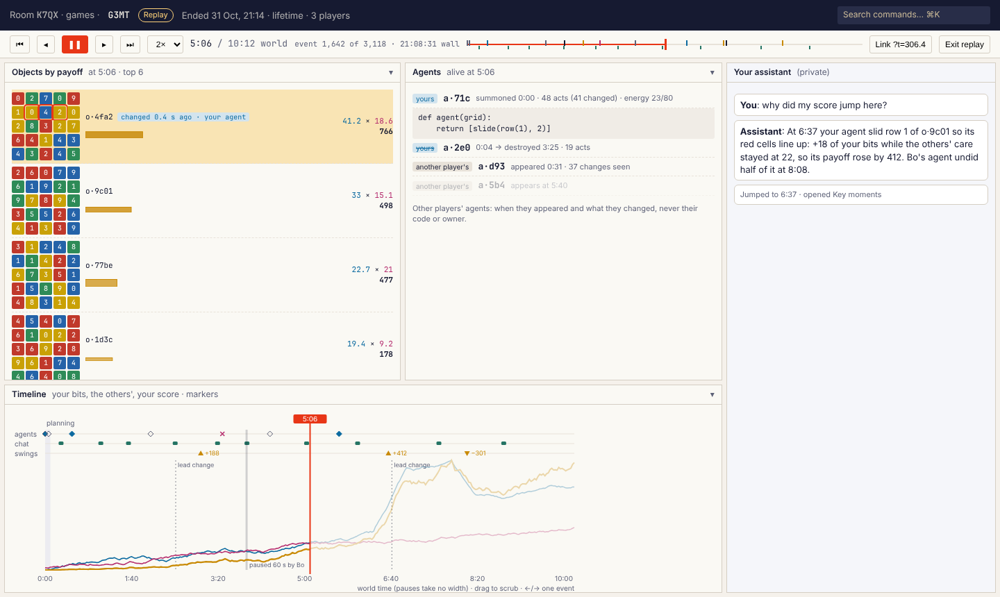
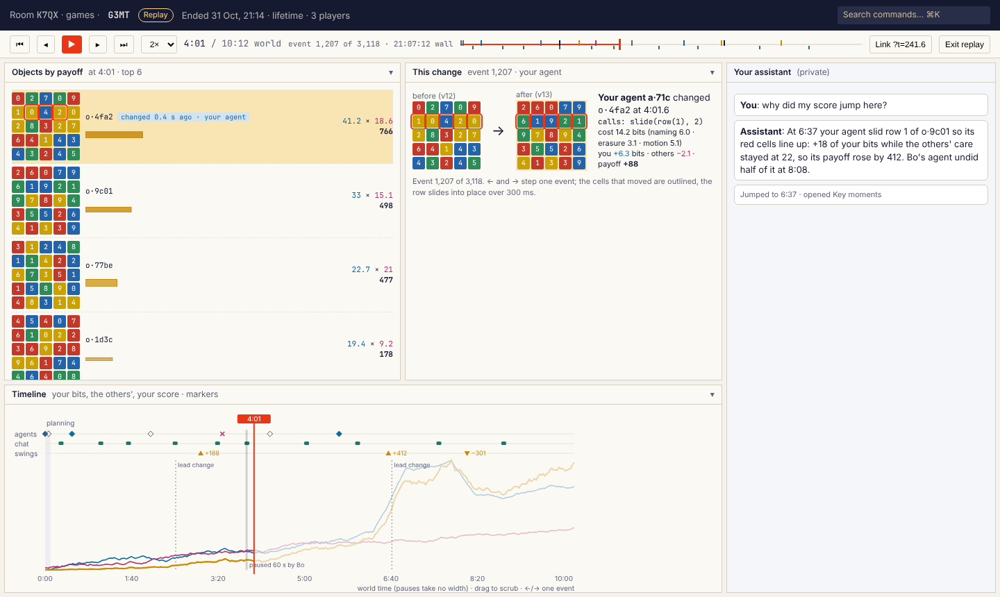
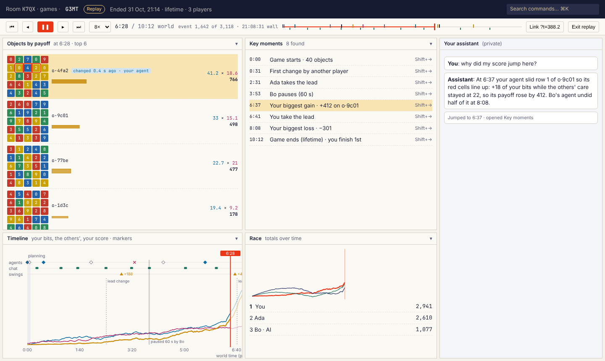
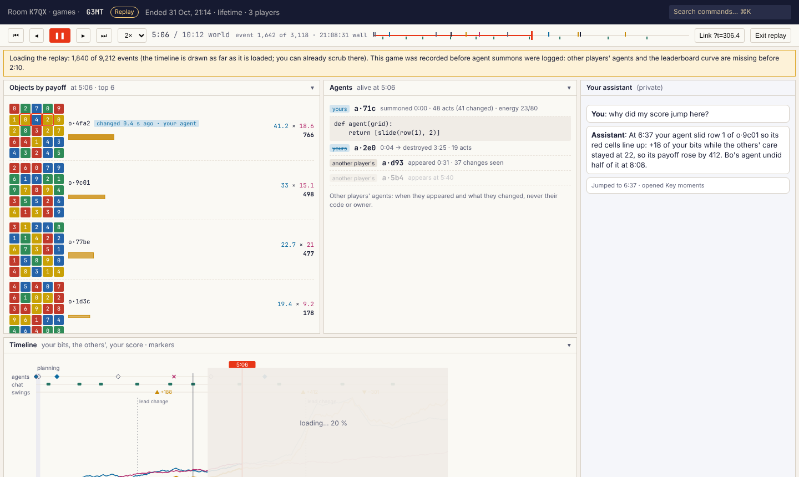
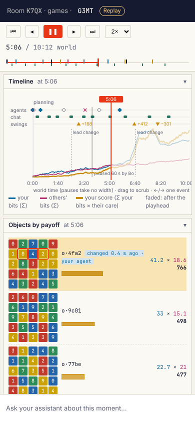

# Replays

A player can open any ENDED game they played in (and a room's owner any of its games) and replay it, tick by tick, with nothing hidden:
every player's utility, every agent's code, whose agent made every move, every score at every moment.

**The rule (the owner's, 2026-11-01): information hiding applies only during live games; ended games are fully
transparent in replays.** While a game runs, every read stays the player's own projection (aggregate-only opponent
information, own agents' sources only, no seeds, no end deadline). Once it has ended, its replay reveals everything,
so players (and their assistants) can study how the others played. The boundary is the game's `ended` phase, enforced
by the engine: `player.replay` refuses a live game.

This document records how the engine makes that possible (§1–§3: the event log, its schema and the
replay API) and how the player client presents it (§4 onwards: the replay view).

Status: §1–§3 shipped with the event-log completeness change (PR #80) and the transparent replay (schema 3, replay API
version 2). §4–§10 are the view's design; the mockups are
in `docs/screenshots/replay/` (`mockup.html`, rendered by `render.mjs`).

## 1. Re-simulate or play back?

**Decision: play back recorded outcomes. Never re-run an agent, a sampler or a scorer to replay a game.**

Re-simulation would need, for every tick, the exact inputs to every nondeterministic step, and the same code:

- **Opportunity scheduling is drawn from a CSPRNG** (`engine/tick.ts`: the opportunity count's stochastic rounding,
  the target object, the eligible agent). Recording those draws is possible, but every one of them would have to be
  logged, and the log would then be a recording of outcomes anyway.
- **Act seeds are salted with the season salt** (`deriveSeed(salt, ["play", gameId, agentId, actIndex])`), a secret
  that never leaves the engine. A replay that re-ran agents would either need the salt (and could then be used to
  predict a live game's acts) or could not reproduce randomized agents.
- **The sandboxes and the scorers change.** CPython WASI and QuickJS bundles are pinned by hash, but they are upgraded;
  utility families and calibration tables are regenerated (`pnpm --filter @workspace/game-utilities calibrate`); the
  mutator preludes evolve. A re-simulated replay of last month's game under this month's code is a different game.
- **Spawns redraw on collisions, and the 2,000-object limit and the 4 s simulate budget drop opportunities.** These
  are host-dependent (wall clock) and cannot be reproduced.
- **Agents are deleted when destroyed**, so their sources would be gone.

Playing back outcomes is robust to every code change: each spawn's value, each transformation's result and calls, each
act's charge, each object's per-god net bits after the event, and each summon's agent record are already facts in the
log. A replay is a fold over those facts. The only code a replay runs is pure arithmetic of game-core (the agent energy
account: `settleAgentEnergy`, `chargeAct`), whose formula is part of the game's rules; if it ever changes, the rules
version (`scoring: "information-v1"`) changes with it.

## 2. What a perfect replay needs, and where it is

Working from what the state of a game is (`games`, `deities`, `objects`, `agents`, `tickBatches`, `chat`) and every
mutation that changes it:

| State | Changed by | In the log as | Before this change |
|---|---|---|---|
| Settings, instance, roster (with AI seats), start time, planning deadline, setup | `game/lobby.ts commitStart` (frozen for the game: settings and seats cannot change while a game is live) | the game document's fixed header | present |
| Initial objects | `commitStart` | batch 0: `phase planning` + one `spawn` per object at world 0 | present |
| Spawns (values, with their random draws resolved) | `engine/tick.ts` | `spawn {objectId, value, version, world, net[]}` | present |
| Transformations | `engine/tick.ts` | `transform {objectId, before, value, version, world, agentId, ownerId, calls, cost, net[]}` | present |
| Failed acts (charged, object unchanged) | `engine/tick.ts` | `fail {objectId, world, agentId, ownerId, reason, cost}` | present |
| Agent summons: source, language, price, act cost, energy account, owner | `game/commands.ts` summon | **`summon {agentId, ownerId, world, language, source, summonCost, decisionBits, expectedActCost, perActFloorBits, breakdown, randomized, account}`** | **missing** (the agent row was the only record, deleted on destroy) |
| Agent destruction | `game/commands.ts` destroy | **`destroy {agentId, ownerId, world}`** | **missing** |
| Agent energy accounts | every act | derived: `account = chargeAct(settle(account, world), cost.total)` per act, from the summon's account | derivable once summons are logged |
| God energy | summons (price) and wall time | derived: `startingEnergy + (wall − startedAt)·energyPerSecond − Σ own summon prices`, frozen at `endedAt`; wall time is each batch's `at` | derivable once summons are logged |
| Object scores (every god's net bits) | spawns, transforms | `net[]` on each spawn and transform, roster order | present |
| Leaderboard | any score change | **`totals[]` on each batch that changed scores**: every god's total payoff after the batch, roster order | **missing** (only the end summary had it) |
| Phases: planning, running, paused (by whom), recovery (why), resumed, ended (why) | loop, commands, owner | `phase {phase, world, reason}` | present |
| Public chat | `game/commands.ts` chat | the `chat` row, **stamped with `gameId` and `world` when sent during a live game** | **missing the world time** (wall timestamp only) |
| Players joining or leaving | `rooms.join`, `rooms.leave` | nothing: the roster is fixed at the start, seated gods cannot leave a live game, joiners spectate | not game state |
| Calibration tables | start (tables computed or shipped) | nothing needed: scores are recorded as net bits, so a replay never consults a table | not needed |
| Settings changes mid-game | refused | nothing | not possible |

Notes on the choices:

- **Chat stays in the `chat` table** rather than becoming a log event. It belongs to the room (it stays open after
  the end), it is rate-limited per author but not per game, and writing one `tickBatches` doc per message would
  fragment the log and push transformations out of the observation's recent-batches window (`lib/load.ts`,
  `RECENT_BATCHES`). A message sent while a game is live (planning to recovery) carries that game's id and its world
  time; the replay API merges them. Messages from before the stamp are placed by wall time against the batches.
- **Totals instead of per-object payoffs.** Each god's total payoff after a batch is exactly what the live leaderboard
  showed after that commit, so it discloses nothing new. Per-object payoffs of other gods would. As with the live
  leaderboard, a batch holding a single transformation lets a careful reader difference the totals; this is the same
  inference the live game allows, and aggregates are not claimed to prevent it.
- **Order.** Events apply in (batch `seq`, index) order, the order the engine committed them. A summon or a pause is
  committed by its own mutation while a tick may be simulating, so its world time can be a little later than the
  first events of the next tick's batch. The reducer seeks by the running maximum of world time.
- **Discarded windows** never reach the log (a discarded commit writes nothing), so the log and the state cannot
  disagree.

**Schema.** Every `tickBatches` doc carries `schema` (`EVENT_LOG_SCHEMA` in `convex/lib/world.ts`, now 2). Version 2
added `summon`, `destroy`, `totals` and the chat stamps. A batch without `schema` predates them: a replay of such a
game has no agent lifetimes, no leaderboard curve, and chat placed by wall time; the replay view says so. Bump the
schema whenever an event's fields or meaning change, and keep the reducer reading every schema it has seen.

**Storage.** The new events are small and rare: a summon is about 400 bytes plus its source (summons are capped by
`maxAgentsPerGod`), a destroy about 120 bytes, `totals` 8 bytes per god per tick batch. The log's size is still
dominated by transformations, about 350 bytes each (ids, values, calls, a six-field charge and one net value per god).
A game's act rate is bounded by agent energy, not by the interaction cap: with the default 2 bits/s of agent income
and acts costing tens of bits, a six-god game runs a few acts per second, about 1 KB/s of log, so a 600 s game is
about 1 MB. A game held at the 100 Hz cap with rich agents writes about 35 KB/s, 20 MB for 10 minutes; that is still
within Convex's limits (batches stay under 400 events, about 140 KB per doc). Compression is not needed yet; if it
becomes so, the place is `appendEvents` (column-packing the `transform` events of a batch), behind a schema bump.

**Test.** `artifacts/engine/test/game-replay.test.ts` plays a game with summons, chat in planning and while running,
a destroy, a pause and an owner end, and captures the engine's raw state at four moments. While the game runs, the
replay is refused. After the end, every seated player gets the same replay, and one player's pages, cut at each
snapshot's last batch, rebuild the whole raw state there: every object (value, version, every god's net bits), every
agent (owner, source, acts, spending, energy account; destroyed ones as destroyed), every god's summon spending and
exact total, and the phase. The reducer's own rules are unit-tested in `lib/player-client/test/replay.test.ts`.

**Seeds (schema 3).** Each transform and fail event carries the act's seed, `deriveSeed(salt, ["play", gameId,
agentId, actIndex])` as a decimal string. It is an HMAC of the season salt, so revealing it reveals nothing about the
salt, which stays secret because it seeds every live game of the season. With the seed, an agent's act can be re-run
in the sandbox to study it; the replay itself never needs to.

## 3. The replay API (public, for every client and assistant)

`player.replay({ roomId, gameId, afterSeq?, chatAfter?, eventOffset?, limit?, maxEvents? })`, a Convex query. Third-party
clients call it like any other public function (docs/engine-api.md); the reference reducer is
`@workspace/player-client/replay`. Assistants read it through the `get_replay` tool (small pages) and, for analysis
over a whole game, through `run_code`'s `replay` dataset (the game flattened: header, gods, every event, chat).

- **Who:** the gods who played in that game (its roster) and the room's owner, as for every past game
  (`lib/rooms.ts requireHistoricReaderAs`). Other room members, spectators of the game included, get `FORBIDDEN`;
  non-members get the room's usual refusal.
- **When:** only once the game has ended. A live game's replay is `CONFLICT` ("The replay opens when the game
  ends"), so none of its hidden information leaves through this door; the `replay` dataset is `null` for it.
- **Paging:** pages of up to `limit` batches (default and maximum 100), stopping before `maxEvents` events (default
  and maximum 4,000; the query reads batch by batch, so it never reads more than it returns). A batch larger than a
  page is split: the page's last batch carries the events it holds and the page returns `eventOffset`. Start with no
  cursor; continue with `afterSeq: nextCursor, chatAfter: chatCursor, eventOffset` until `done` (the log is read
  and so is the chat to the end; `maxChat` caps a page's messages). `get_replay` packs the three into one opaque
  `cursor` and shrinks its pages until they fit a tool result.
- **Result (version 2):**
  - `version`: the replay API version. The reducer refuses a version it does not know.
  - `game`: id, short code, phase, `startedAt`, `planningEndsAt`, `endedAt`, `endReason`, `worldSeconds`, `endAtWorld`,
    settings, setup, roster (`{id, name, kind}`), object instance, season commitment, engine stats; on the first page
    `logSchema` (the log's schema) and `currentLogSchema`.
  - `viewer`: the caller's god id and roster index (the view's default point of view, nothing more).
  - `gods` (first page): every god's dealt utility descriptor and kid card, final summon spending, whether it paused,
    and an AI seat's library agent (name, provider, model, prompt).
  - `batches`: `{seq, at, worldFrom, worldTo, from?, events}` (the stored `totals` are not served: every god's exact total follows from `net` after every event); every event in full: `object.spawned` and
    `object.transformed` with `net` (every god's net bits after it, roster order), transforms and `agent.failed` with
    the agent, its owner, the calls, the charge and the seed; `agent.summoned` with owner, language, source, price, act
    cost and starting account; `agent.destroyed` with owner; `phase` with its reason.
  - `chat`: the game's messages after `chatAfter` up to the page's last batch (to the end on the last page), at most
    500, each with `worldSeconds` when stamped.
  - `nextCursor`, `eventOffset?`, `chatCursor`, `latestCursor`, `done`.
- **Mixed logs.** `logSchema` is the first batch's schema. Below 2 the log has no summons, totals or chat stamps (for
  the part recorded before the deploy): agents appear from their acts, attributed but without their source; below 3
  acts have no seed.

**Tests of the boundary.** `test/game-disclosure.test.ts`: every live read and every ended-game read other than the
replay stays aggregate-only for the viewer; the live replay is refused; the ended replay contains every other god's
descriptor and agent source, the AI seat's prompt and the end deadline. `test/mcp.test.ts`: the same through
`get_replay`. `test/game-code.test.ts`: the `replay` dataset is null while live and holds every agent's code after.

The frozen end state's own reads (observation, events, history: PR #47) keep their projection: they serve the player's
own panels. Everything else about an ended game is in its replay.

## 4. The view: a replay mode of the dock, not a separate app

| Scrubbing (paused mid-game) | Stepping one event |
|---|---|
|  |  |
| **Key moments and the race** | **Loading a long legacy game** |
|  |  |

Phone (stacked dock, the transport strip on top): 

**Decision: a replay is the player client in a read-only mode at a moment of the past.** Every built-in panel and
every stored panel renders the game *as it was at the playhead*, and one new built-in panel, the **Timeline**, drives
the playhead. A thin **transport strip** under the header is the shell's own chrome in replay mode.

Why this shape:

- **Panels read the game through one seam.** Every SDK hook (`useObservation`, `useGame`, `useObjects`, `useMyAgents`,
  `useLeaderboard`, `useChat`, `useEvents`, `useTrajectories`) goes through `useSdkQuery(name, args)`. In replay mode a
  `ReplayProvider` answers those five queries from the reducer's state at the playhead instead of from Convex. The
  objects panel, the race, the feed, others' care, bits over time, my card, results and public chat then replay with
  no change to their code, and so do the player's **stored panels**: their sandboxed frames reach the SDK through the
  host bridge, which calls the same `useSdkQuery`. A replay is as rich as the player's own workspace, and a panel
  someone writes for live play works in replays for free.
- **It is the reference implementation for other clients.** Their recipe is the same: page `player.replay`, fold it
  with `@workspace/player-client/replay`, and render the folded state with whatever they already render live state
  with. The only new contract is the replay page and the reducer (§3).
- **The dock stays the dock.** Panes move, split and close as in live play; the human picks panels from the menu;
  the assistant sets their parameters. Nothing new to learn.

**The synthesized observation** (`replayObservation(replay, state)`, pure, in `lib/player-client/src/replay.ts`, tested
against the live observation at the end of a game): phase `ended` (whatever the phase was at the playhead, so every
action is refused the way the frozen end state refuses it; the real phase at the playhead shows in the strip),
`economy.worldSeconds` = the playhead, `self.energy` = `godEnergyAt`, objects from the state (own, peer, care, payoff),
the point-of-view god's agents alive at the playhead with energy settled to the playhead and their source, the
leaderboard from the exact totals, transformations up to the playhead (the last 500), chat up to the playhead.
`player.events` and `player.trajectories` are answered from the log prefix in their own shapes, and
`player.myUtility` from `gods`, so the what-if panel and the evaluator work on past games too.

**Point of view.** Because the replay is transparent, the observation can be synthesized for ANY god: a "Seen as"
menu in the strip (default: you) switches every panel to another player's view of the game, with that god's card,
bits, agents and payoffs, so a player can watch the game through each opponent's eyes. The Timeline shows every god
at once (§5).

**Read-only.** The forge shows a selected agent's source (anyone's) with Validate and Summon off ("This is a replay");
pause, chat input and owner actions are hidden behind the same reason the frozen end state gives. The palette marks
game actions unavailable. The assistant stays: it is the player's, and in replay mode its context gains the playhead
(§8).

## 5. The transport strip and the Timeline panel

**The strip** (always visible in replay mode, 40 px; mockup `scrub.png`, top): previous key moment, previous event,
play/pause, next event, next key moment, speed, the clock (`5:06 / 10:12 world`), the event counter and the wall
time, a one-line overview of the whole game with the playhead (click to seek), "Link" (copies a deep link, §7) and
"Exit replay". It is chrome, not a pane, so closing every panel can never strand the player without a way to move
time; it is the only control a phone needs (`mobile.png`).

**The Timeline panel** (`timeline`, a built-in panel, open by default in replay mode under the main panel; `scrub.png`
bottom) is the instrument:

- **Axis.** World time, because that is the game's clock: agent energy, spawns and the lifetime all run on it. Pauses
  and recovery take no world time, so they draw as a notch (a vertical band of zero width with "paused 60 s by Bo");
  planning is a band at 0. The wall time of the playhead shows in the strip. An "events" axis (uniform per event) is a
  parameter for dense stretches.
- **Curves** (one scale per meaning, in the colours every panel already uses): for the point-of-view god, Σ own net
  bits (petrol blue), Σ the others' net bits (raspberry), and the score Σ own bits × the others' care (amber, thicker;
  the product is what the player is ranked by); scores are exact at every event, not stepped. A parameter overlays
  every god's score (the race's lines) instead. Everything after the playhead is drawn faded, so the shape of the whole game is visible while
  the past stays legible. A parameter overlays the leaderboard totals (the race's lines) instead.
- **Marker lanes** above the curves, each with its own glyph so they never compete: agents (a summon: a diamond in its
  owner's colour, clicking it opens the agent's code; a destroy: a cross), chat (a small bubble per message),
  swings (an amber triangle at each of the largest changes of own score, labelled with the change), and lead changes
  (a dashed rule through the curves). Spawns are not markers: there are hundreds; they show as a density tick strip
  under the axis.
- **Interaction.** Drag anywhere to scrub; click a marker to jump to it; hovering shows the marker's sentence ("Your
  agent a·71c changed o·4fa2: +88"). Keyboard (when the timeline or the strip has focus, or anywhere when no input
  does): Space play/pause, ←/→ one event, Shift+←/→ previous/next key moment, Home/End, `[`/`]` speed down/up,
  `L` copy link.

**Playback.** The playhead advances in world time at the chosen speed (¼×, ½×, 1×, 2×, 4×, 8×, 16×, 64×; default
2×, since most of a game is waiting). "Skip quiet" (on by default) jumps over stretches with no events longer than
2 s of playback. Stepping by event moves the cursor exactly one log entry, whatever its world time.

**Parameters** (set by the assistant, like every panel): `overlay` (`curves` | `race`), `lanes` (which marker lanes),
`axis` (`world` | `events`), `swings` (how many to mark, default 5).

## 6. The board at time t, with the change animated

The objects panel (and the grid views of lib/object-views) shows each object's value at the playhead. When the
playhead crosses a transformation, its object row flashes amber and moves to its new rank; on a Grid the changed
cells are outlined and the change animates over 300 ms (a slide moves its row or column, a recolour fades); on Int and
string the old value cross-fades to the new. At high speed (more than about 20 changes per second of playback)
animation gives way to the flash alone.

Stepping by event opens the **This change** card (`step.png`): before and after side by side, the agent and its
owner, the calls, the charge, the seed, and the change in every god's bits and payoff. Clicking the agent opens its
code. The card is a mode of the feed panel (`feed` with `focus: "cursor"`), not a new panel.

## 7. Routes, deep links and entry points

- `/client/rooms/:roomId/games/:gameId` opens the game. A finished game opens in replay mode at its end (the frozen
  final state, which is where a player arriving from the results most wants to start), with the playhead at the end.
- `?t=<world seconds>` seeks to that world time; `?e=<event index>` to an exact event (it wins over `t`);
  `&play=1&speed=4` starts playing. "Link" writes the current position (`t` while paused between events, `e` after
  stepping). The URL is updated with `replaceState` when the playhead stops, never while playing.
- Entry points: the results panel's past games list ("Replay"), the room page's game list, the end-of-game results
  ("Watch the replay"), and the palette ("Replay a game I played…", from the catalogue entry of `player.replay`).
- A live game's page is the live client. There is no replay of a live game: it would reveal what live play hides.

## 8. The assistant in a replay

The assistant pane stays, private as ever. In replay mode the client passes the playhead (world seconds, event
index) with each message. The assistant reads the whole revealed game through `get_replay` and, for analysis
(how did Ada's agents earn their points? which mutators paid off for whom?), through `run_code` with the `replay`
dataset. It can explain a moment ("why
did my score jump here?") and move the view through the layout tools (open Key moments, set the Timeline's overlay).
A future `seek_replay` tool would let it move the playhead; it is a client-side view change like `open_panel` and
needs no engine function. Key moments (`moments.png`) are computed client-side: the start, the first change by another
player, lead changes (from totals), the largest own gains and losses, pauses and recoveries, the end. They are a mode
of the overview panel (`overview` with `focus: "moments"`).

## 9. Performance for long games

- **Loading.** Pages of up to 4,000 events stream in (`player.replay` with both cursors); the view opens at once with
  the first page, the timeline draws as far as it is loaded (the rest shaded, `loading.png`), and the player can scrub
  in the loaded part. A 10-minute game at the interaction cap (about 60,000 events) is 15 pages; a typical game is 1–3.
- **Seeking.** The reducer keeps a keyframe every 256 events (widened to keep at most 256 keyframes), so any seek
  costs at most one keyframe copy plus a keyframe interval of folds. Playing forward folds incrementally from the
  current state; only backward seeks restore a keyframe.
- **Rendering.** The synthesized observation is recomputed at most 10 times a second while playing (panels already
  throttle to their `hz`); the Timeline's curves are computed once per load into per-batch arrays (one point per batch,
  not per event) and drawn as one path each.
- **Memory.** Keyframes hold the objects and agents maps (at most 2,000 objects): about 256 × 2,000 small records at
  worst. A future version could make keyframes structural-sharing maps; it is not needed at the measured sizes.
- **Caching.** Pages of an ended game never change: the client keeps them in memory for the session (and may cache
  them in IndexedDB keyed by game id and `logSchema`).

## 10. Edge cases

- **Legacy logs** (`logSchema` 1, or a game that was live during the schema-2 deploy): the strip shows a notice that
  agents' code and exact chat times are missing for the part recorded before; agents appear from their acts,
  attributed, without their source. Scores are exact throughout (they come from the per-god net bits).
- **Recovery and idle parking** show as notches like pauses, labelled with their reason; world time does not move
  during them, so the axis is unaffected.
- **Spectators** (members who were not seated) get no replay, by the API's contract; the room page's game list shows
  them the public game page instead.
- **An AI seat** replays like any god, with its library agent's name, model and prompt in the roster.
- **Disclosure** is the API's (§3): nothing until the game ends, everything after.
